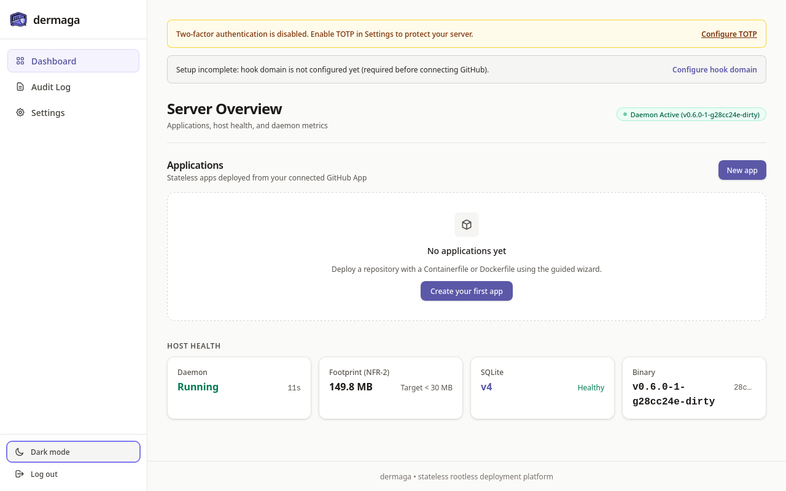
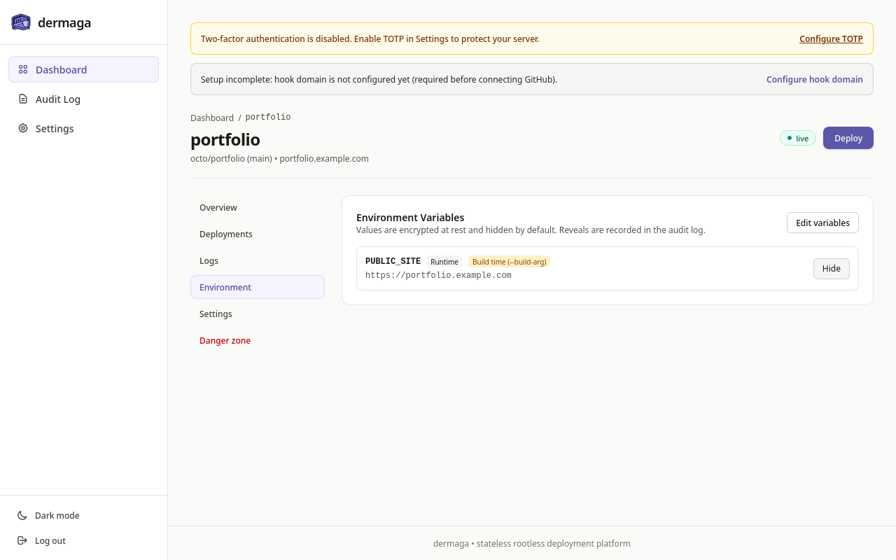
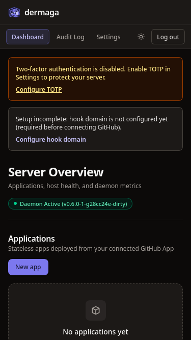

# dermaga

Turn a fresh Debian 13 VPS into a hardened, rootless Podman host and deploy web applications from GitHub through a private web panel.

> **Status:** Pre-1.0 (`v0.6.0`), under active development. See [docs/PLAN.md](docs/PLAN.md) for milestone progress and scope.

## What is dermaga?

**dermaga** (Indonesian for "pier") is a single-binary, self-hosted deployment platform for a single Debian 13 server. It replaces manual server setup, reverse-proxy configuration, and ad-hoc deploy scripts with:

- **Rootless Podman + Quadlet** managed under a dedicated unprivileged `server` user (`systemd --user`)
- **Traefik v3** reverse proxy with socket-activated `:80`/`:443` and automatic Let's Encrypt HTTPS
- **Private web panel** bound strictly to `127.0.0.1:7070`, accessed over an SSH tunnel (`ssh dermaga`)
- **GitHub App integration** with encrypted credentials, per-fetch installation tokens, and a dedicated webhook relay

## Features

### Available today (`v0.6.0`)
- **Hardened Debian 13 installer** (`install.sh`): configures `nftables`, `sshd` (with anti-lockout verification), `fail2ban`, `sysctl`, `zram`, unattended upgrades, rootless Podman, and `dermaga.service`.
- **First-run setup & auth**: single-use setup token, Argon2id admin password, optional TOTP 2FA, active session management, and immutable audit log.
- **GitHub App connection**: guided manifest flow from the panel, repository sync, and HMAC-SHA256 verified webhook intake (`/hooks/github-app` via `hook-relay`).
- **Guided New App Wizard**: repository/branch inspection (`Containerfile`/`Dockerfile`, `EXPOSE`), build-time and runtime environment variables (AES-256-GCM at rest, masked by default with audited reveal), resource limits, health checks, and live SSE build/runtime logs.

### Roadmap (not yet implemented)
- **M7 (`0.7.0`)**: Zero-downtime blue-green redeploys, push-to-deploy on webhook, instant rollback.
- **M8 (`0.8.0`)**: Custom domains, per-app HTTPS status, security headers, and middleware controls.
- **M9 (`0.9.0`)**: App runtime status, disk usage and image cleanup, expanded `doctor` checks.
- **M10 (`0.10.0`)**: In-panel self-updates and VPS migration guide.
- **M11 (`1.0.0`)**: Full security self-review, threat model, and operational documentation.

See [docs/PLAN.md](docs/PLAN.md) for acceptance criteria.

## Requirements

- **Server**: Fresh **Debian 13** (Trixie) VPS (`x86_64` or `arm64`), minimum 2 GB RAM.
- **Domain**: A domain where you can add DNS `A`/`AAAA` records (a dedicated subdomain is used for GitHub webhooks).
- **SSH key**: An SSH public key on your laptop (added when creating the VPS, or pasted during install).

## Install

Log in to your fresh Debian 13 server and run the installer for the release tag you want (for example `v0.6.0`):

```bash
curl -fsSL https://github.com/r3p-dev/dermaga/releases/download/v0.6.0/install.sh | sudo bash
```

To inspect `install.sh` before running it:

```bash
curl -fsSLO https://github.com/r3p-dev/dermaga/releases/download/v0.6.0/install.sh
less install.sh
sudo bash install.sh
```

The installer verifies the `dermaga` binary SHA-256 against `checksums.txt` from the same release before installing it, confirms your new SSH login in a second terminal before closing the old port, and prints a single command to configure `ssh dermaga` on your laptop.

## First-Run Setup

1. On your laptop, run the `ssh dermaga` command printed by the installer (it forwards `localhost:7070` to the server's `127.0.0.1:7070`).
2. Open the setup URL printed by the installer (`http://localhost:7070/setup?token=...`).
3. Create your admin password, optionally enroll TOTP 2FA, and set your reserved webhook domain.
4. Go to **Settings → GitHub** to create and install your GitHub App, then click **New app** on the Dashboard.

### Server Commands

All normal administration happens in the web panel. Three recovery/helper commands exist on the server:
- `dermaga panel` — prints the laptop SSH config command (and setup link if uninitialized)
- `dermaga admin set-password` — resets the admin password
- `dermaga admin totp disable` — emergency TOTP recovery

## Screenshots

| Dashboard (Desktop, Light) | App Environment (Desktop, Light) |
| --- | --- |
|  |  |

| Dashboard (Narrow, Dark) |
| --- |
|  |

## Security Model

- **Zero root at runtime**: everything runs under the unprivileged `server` user.
- **No public panel**: the panel binds only to `127.0.0.1:7070` with `Host`/`Origin` DNS-rebinding protection and `HttpOnly; SameSite=Strict` sessions.
- **No container socket access**: neither Traefik nor app containers have access to `podman.sock`.
- **Encrypted secrets**: GitHub App keys, webhook secrets, and environment variables are encrypted at rest with AES-256-GCM; webhook signatures (`X-Hub-Signature-256`) are verified in constant time before JSON parsing.

## Documentation

- [Architecture](docs/ARCHITECTURE.md)
- [Development & Milestone Plan](docs/PLAN.md)
- [Development Setup & Test VM](docs/SETUP.md)
- [Code Conventions](docs/CONVENTIONS.md)
- [Dependencies](docs/DEPENDENCIES.md)

## Contributing & Development

Prerequisites: Go 1.27+, Bun 1.4+ (see [docs/DEPENDENCIES.md](docs/DEPENDENCIES.md) for pinned versions).

```bash
# Run formatting, linting, unit/API/browser tests, and vulnerability checks:
make check

# Build the static binary with embedded UI:
make build
```

## License

MIT. See [LICENSE](LICENSE).
