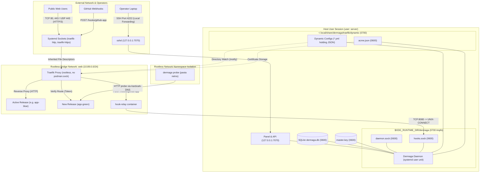
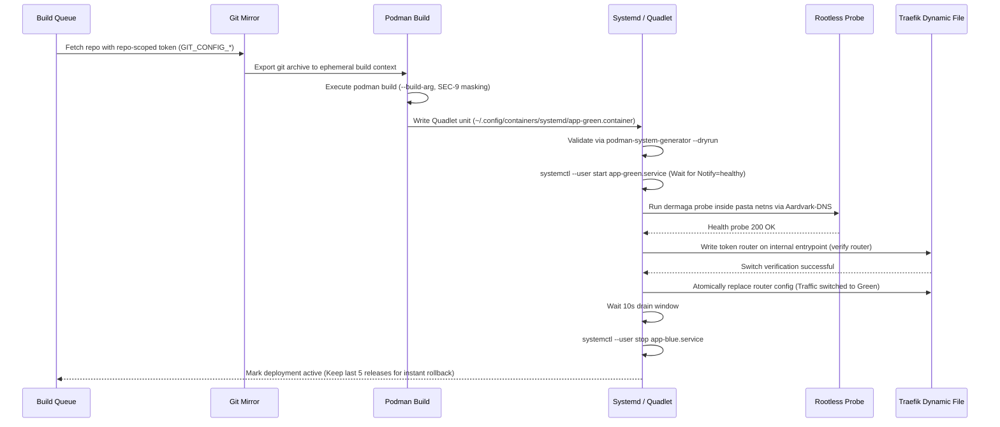

# Architecture

**§1 is set by the project owner.** Do not change it without asking; if you believe a decision must
change, say so in your report and why. Decisions marked **(verify in M0)** rest on host behavior that
M0 confirms on `dermaga-vm` before code depends on it. **§2 onward is written and kept current by the
implementer** (first in M0, then whenever packages, routes, schema, state machines, generated files or
decisions change).

---

## 1. Fixed decisions

### 1.1 Technology

| Area               | Decision |
| ------------------ | -------- |
| Language and build | **Go**, standard library first (`net/http` routing, `database/sql`, `flag`, `log/slog`, `crypto/*`, `embed`, `os/exec`). **One static binary** (`CGO_ENABLED=0`) for amd64 and arm64 that is the daemon, the three server commands (`SRV-1`), and the small helpers that run elsewhere (`hook-relay` inside the hook relay container, `probe` inside the rootless network namespace). Linters and code generators as `tool` directives in `go.mod`. `make check` runs everything. |
| Web UI             | **SvelteKit** with `adapter-static` (SPA), **Svelte 5 runes**, **Tailwind CSS v4**, TypeScript strict, built with **Bun** (`bun.lock` committed), embedded in the binary. No Node or Bun at runtime. API types generated from Go structs (tygo). The panel is the only user interface. |
| Host               | **Debian 13 only.** One Linux user `server` owns everything. dermaga runs as a **systemd user service** with lingering; it refuses to run as root. |
| Containers         | **Rootless Podman with Quadlet** under the systemd user manager. No Docker, no Compose, no Podman API socket in any container. Every generated unit set is validated with Quadlet's dry run before it is installed. Units declare `[Quadlet] DefaultDependencies=false` to eliminate the 90 s `podman-user-wait-network-online.service` boot delay. Resource limits mapped via `PodmanArgs=--memory=... --cpus=...`. Apps are stateless: no volumes in v1. |
| Reverse proxy      | **Traefik v3** in a container, socket-activated on :80/:443 (TCP 80 via `traefik-http.socket`, and TCP + UDP 443 via `traefik-https.socket` with shared `FileDescriptorName=websecure` for HTTP/3, verified in M0 on production and `dermaga-vm` per HOST-6) by user-manager sockets, **file provider only**. dermaga writes every dynamic file from typed structs (as JSON, which Traefik accepts in `.yml`). Default middleware reproduces `vps-setup.sh`'s headers, rate limit and compression; middleware chains are per router. |
| HTTPS              | **Traefik's ACME** with Let's Encrypt issues and renews certificates; dermaga only configures the resolver and reads the result to show certificate status (`TLS-3`). Certificate storage at `~/.local/share/dermaga/traefik/acme.json` owned by `server`, 0600. Development uses Pebble (local ACME test server) on `dermaga-vm` behind NAT; staging/production on real hosts. (verified in M0: HTTP-01 and TLS-ALPN-01 both work with socket activation, see EVIDENCE.md §7). |
| Panel access       | The panel listens on **`127.0.0.1:7070` only, in every state** (including install and setup), reached through SSH local forwarding. No public panel, no inbound listener for GitHub. |
| Server commands    | The three commands of `SRV-1` talk to the daemon over a **Unix socket (0600)**; its file mode is the authentication. If the daemon is inactive, recovery commands (`dermaga admin set-password` and `dermaga admin totp disable`) fall back to direct SQLite access via the shared store package (WAL + `busy_timeout`), revoking all active sessions. |
| State              | **SQLite** (`modernc.org/sqlite`, no cgo), one database file at `~/.local/share/dermaga/dermaga.db` (0600), numbered SQL migrations. Until v1.0.0, schema changes may **edit the original migration** (the dev database is reset); from v1.0.0 on, new migrations only. Settings live in SQLite; there is no config file to edit. |
| Secrets            | Encrypted at rest with **AES-256-GCM** under a master key file at `~/.config/dermaga/master.key` (0600), bound to their column. Env files for Podman are plaintext 0600 (stated honestly in the docs). |
| GitHub             | **GitHub App only.** Created by the manifest flow from the panel with redirects to `localhost:7070` in the browser; webhook URL and freshly generated 32-byte secret configured post-conversion via `PATCH /app/hook/config` (App JWT); per-fetch installation tokens scoped to one repo, passed to git through environment config only (HTTP Basic auth `x-access-token`); the App JWT on `crypto/rsa`; a handful of REST endpoints on `net/http`. |
| Webhooks           | One server-wide endpoint, served on a **Unix socket** (`$XDG_RUNTIME_DIR/dermaga/hooks.sock`) and reached by Traefik through a tiny relay container on network `web` that forwards bytes and parses nothing. Reached via canonical path `/hooks/github-app` on the reserved hook domain. No new host TCP port. All validation in the daemon: HMAC `X-Hub-Signature-256` constant-time compare, reject non-POST, bounded read (`http.MaxBytesReader`) with 25 MiB body cap, unknown events 2xx ignored (verified in M0 per SEC-3 and SEC-11; see EVIDENCE.md §4 and Step 2 §5). |
| Deploys            | One global build queue. Bare mirrors and `git archive` exports in cache; `podman build` with limits; build-time variables passed as `--build-arg`, with clear notice that values can be embedded in image history (secrets must not be set as build variables; `--secret` mount deferred to v1.1, verified in M0). **Blue-green only.** Health checks run from the rootless network namespace (5 s stability window if health check is "none", verified in M0; see EVIDENCE.md §5). Every route change is **verified through Traefik** (a temporary per-switch token router on an internal entry point) and restored on failure. Images and runtime configuration snapshots of the last 5 releases kept for rollback. |
| Installer          | **Bash**, interactive, from a GitHub release asset; checksum-verified binary download. Ensures host systemd wires `multi-user.target` to `network-online.target` so system-level network readiness succeeds in < 2 s. |
| Updates            | In the panel on request: checksum-verified download, atomic replace, automatic restore of the previous version if the new one fails to start. |
| Language           | UI, server command output, code, comments, docs and commit messages English. |
| Delivery           | GitHub releases: static binaries for both architectures, `checksums.txt`, `install.sh`. |

### 1.2 Security requirements (all mandatory)

Exposure

- **SEC-1** Nothing runs as root after installation.
- **SEC-2** The panel binds `127.0.0.1` only and is reachable only through SSH local forwarding, at
  every moment, including install and first-run setup.
- **SEC-3** DNS-rebinding protection: requests whose `Host` is not `127.0.0.1:<port>` or
  `localhost:<port>` are rejected; mutating requests need a matching `Origin`.
- **SEC-4** The only public entry points are Traefik on 80/443 and the canonical `/hooks/github-app`
  path on the hook domain. No new host TCP port; no published container ports.
- **SEC-5** No container, including Traefik, gets the Podman API socket.
- **SEC-6** Network access never replaces the panel login.

Authentication and secrets

- **SEC-7** argon2id password, optional TOTP, login backoff. Session cookie `HttpOnly;
  SameSite=Strict; Path=/`, only its hash stored; idle and absolute limits enforced on the server.
- **SEC-8** Setup token: 32 random bytes, stored hashed, single use, expires after 24 h, accepted only
  on the loopback listener, invalid once an admin password exists.
- **SEC-9** Every secret (env values, the GitHub App key and webhook secret) encrypted at rest; never
  logged; never returned after creation except through an explicit, audited reveal; masked in build
  logs.
- **SEC-10** Password and TOTP changes on the panel require re-authentication.

Webhooks

- **SEC-11** Verify `X-Hub-Signature-256` (HMAC-SHA256, constant-time compare) **before** parsing JSON;
  bounded read (`http.MaxBytesReader`) with body limit 25 MiB. On verification failure, log only the
  delivery ID, event, source and "signature mismatch" — never log the expected signature, received
  signature, secret or payload (avoids turning logs into a signature oracle).
- **SEC-12** Accept only `push` and the installation events; deploy only for a repo and branch that
  belong to an app.
- **SEC-13** Dedupe on `X-GitHub-Delivery`; respond `202` immediately and enqueue; rate-limit per app
  after the signature is valid.
- **SEC-14** Responses don't reveal whether a repo is known: an unknown repo gets the same `202` as a
  known one.
- **SEC-15** Every listener has read-header, read, write and idle timeouts.

Host commands and generated files

- **SEC-16** No shell interpolation anywhere: commands run as argument lists with timeouts, also inside
  containers.
- **SEC-17** Every name that reaches a command or a path is validated
  (`^[a-z][a-z0-9-]{0,30}[a-z0-9]$` plus reserved names).
- **SEC-18** Generated files come from typed serialization, written atomically; dermaga never touches a
  unit or file without its own prefixes.

Containers

- **SEC-19** `NoNewPrivileges`, all capabilities dropped by default (per-app additions), memory, CPU and
  pids limits by default, no privileged mode, no host bind mounts, no volumes.

Supply chain

- **SEC-20** Minimal dependencies, each justified in `docs/DEPENDENCIES.md`; lockfiles committed; exact
  versions everywhere, including CI actions (by SHA) and images (tag and digest).
- **SEC-21** `govulncheck` in CI; advisories re-checked at every milestone.
- **SEC-22** The installer and the panel's update refuse a binary whose checksum cannot be verified.
- **SEC-23** No telemetry, no phone-home.

Accepted residual risks (each goes into `docs/THREAT-MODEL.md`): all apps share network `web`, so an
app can reach another app directly; `net.ipv4.ip_unprivileged_port_start = 80` for the user-manager
sockets; plaintext env files (0600); a sudo-capable `server` user.

---

---

## 2. Overview

Dermaga is designed as an autonomous, single-binary server platform running entirely within the unprivileged user session of Linux user `server` on **Debian 13**. It isolates application containers, reverse proxying, and administration through strict boundary layers:



### Boundary & Exposure Rules
1. **Public Inbound:** Only ports `80` (TCP), `443` (TCP and UDP for HTTP/3), and `4222` (SSH) are listening on host interfaces. Ports 80 and 443 are owned by systemd user sockets (`traefik-http.socket`, `traefik-https.socket`) and inherited by Traefik. No container exposes host ports directly (`HOST-1`, `HOST-6`, verified in [EVIDENCE.md §7](evidence/M0/EVIDENCE.md#7-spike-34-traefik-acme-with-socket-activation--http3-decision)).
2. **Panel Inbound:** The administration panel and API listen strictly on `127.0.0.1:7070` (`PAN-1`). External access requires an authenticated SSH tunnel with local port forwarding (`ssh -N -L 7070:127.0.0.1:7070 server@host -p 4222`). Stream-local forwarding is refused by sshd (`HOST-2`, `LAP-3`, verified in [EVIDENCE.md §11](evidence/M0/EVIDENCE.md#11-spike-38-ssh-port-forwarding--stream-local-enforcement)).
3. **Webhook Intake:** Webhooks arrive over public HTTPS at `/hooks/github-app` on the dedicated hook domain. Traefik routes these requests over bridge network `web` to a minimal `hook-relay` container, which forwards bytes directly to `$XDG_RUNTIME_DIR/dermaga/hooks.sock` without parsing (`SEC-3`, verified in [EVIDENCE.md §4](evidence/M0/EVIDENCE.md#4-spike-31-hook-relay--host-loopback-isolation)).
4. **Host Isolation:** Application containers reside on rootless bridge network `web` (`10.89.0.0/24`). Netavark and Pasta ensure containers cannot route to host loopback `127.0.0.1` (`HOST-3`, verified in [EVIDENCE.md §4](evidence/M0/EVIDENCE.md#4-spike-31-hook-relay--host-loopback-isolation)).
5. **Zero Podman Socket Access:** Neither Traefik nor application containers have access to `podman.sock` (`SEC-5`). Traefik uses the file provider exclusively.
6. **Internal Health Probes:** Container health checks originate inside the rootless network namespace via `aardvark-dns` container name resolution, eliminating host port publication (`DEP-1`, verified in [EVIDENCE.md §5](evidence/M0/EVIDENCE.md#5-spike-32-http-probe-in-rootless-netns-via-aardvark-dns)).

---

## 3. Components

### Code map

One line per directory that exists in the repository; start here, then read the detail below.

| Path | Purpose |
| --- | --- |
| `cmd/dermaga/` | CLI entry point: daemon, recovery commands, `panel`, `doctor`, helpers (`main.go`) |
| `internal/access/` | Laptop command `LAP-1` (marked `Host dermaga` block) from the stored address, port and key fingerprint |
| `internal/auth/` | Argon2id passwords, sessions with idle and absolute limits, login rate limiting, TOTP |
| `internal/builder/` | Bare Git mirror caching, `git archive` export, `podman build` with limits (`DEP-7`), chunk-safe `SEC-9` masking, bounded `LogHub` (`DEP-8`, `LOG-2`) |
| `internal/config/` | XDG paths, default port and socket paths (`paths.go`) |
| `internal/crypto/` | AES-256-GCM at rest bound to column names, master key, HMAC verification |
| `internal/deploy/` | Single global build queue (`DEP-5`), first-deploy orchestration (`DEP-3`, `DEP-9`), health probing (`APP-5`), cancel/failure cleanup (`DEP-6`), app removal (`APP-9`) |
| `internal/doctor/` | Host health checks (`DOC-1`) and how to fix each failure |
| `internal/github/` | GitHub App JWT (`crypto/rsa`), manifest flow, installations, repositories, repo-scoped tokens (`GHA-1`–`GHA-6`, `DEC-09`) |
| `internal/host/` | The host boundary: commands with argument slices and timeouts, atomic writes; faked in tests |
| `internal/name/` | Project name and every derived prefix (`dg-`, `app-`) |
| `internal/quadlet/` | Quadlet unit generator (apps, Traefik), golden files in `testdata/` |
| `internal/reconciler/` | Startup reconciliation (`DEP-10`), Traefik and `hook-relay` install/start |
| `internal/server/` | Loopback HTTP server, Unix socket server, embedded UI (`dist/` is built by `make ui`) |
| `internal/store/` | SQLite persistence and migrations |
| `internal/traefik/` | Traefik static and dynamic file generator, pinned image (`types.go`) |
| `internal/webhook/` | `hooks.sock` GitHub webhook intake (`GHA-7`, `GHA-8`, `SEC-11`–`SEC-14`) |
| `install/` | `install.sh` (runs as root), its fake-host tests (`install_test.go`), fixtures in `testdata/` |
| `ui/` | SvelteKit panel: `src/routes/` pages, `src/lib/` API client and generated types, `e2e/` Playwright tests, `scripts/` UI tooling |
| `test/vm/` | VM scenarios and demo state (`seed.sh`) for `dermaga-vm` |
| `test/ci/` | Local rehearsal of CI and release workflow jobs (`simulate_release.sh`) |
| `scripts/` | Repository tooling: `evidence-run`, `check-commits`, `check-policy` (part of `make check`) |

Dermaga is organized strictly per `docs/CONVENTIONS.md` into `cmd/dermaga`, `internal/<package>`, and an embedded SvelteKit 3 Single-Page Application:

### Entrypoint & Subcommands (`cmd/dermaga`)
- `cmd/dermaga`: Main CLI entrypoint for the single static binary (`CGO_ENABLED=0`). Runs the long-running daemon (`dermaga daemon`), server recovery commands (`dermaga admin set-password`, `dermaga admin totp disable`), operator status helper (`dermaga panel`), health check diagnostic (`dermaga doctor`), and small rootless helpers executed elsewhere (`dermaga hook-relay` inside the hook relay container, `dermaga probe` inside the rootless network namespace).

### Internal Packages (`internal/`)
- `internal/config`: Paths and directory resolution per XDG base directory specification, default port and socket paths (`$XDG_RUNTIME_DIR/dermaga/daemon.sock`, `~/.local/share/dermaga/dermaga.db`).
- `internal/auth`: Session token generation (CSPRNG, SHA-256 token hashing), Argon2id password hashing and constant-time verification, session expiration and revocation (`SEC-6`, `SEC-7`).
- `internal/host`: Host boundary interface and execution layer (`CONVENTIONS.md` §0.5). Executes all host commands via `exec.CommandContext` with argument slices and timeouts, strictly without shell interpolation (`SEC-16`), and performs atomic file writes (`fsync`, tempfile rename, directory `fsync`). Replaced with a fake host in unit and integration tests.
- `internal/name`: Single source of truth for the project name and all derived resource identifiers and prefixes (`dg-`, `app-`), guaranteeing consistent naming across Quadlet files, systemd services, container names, networks, and Traefik routers (`CONVENTIONS.md` §2). Never hard-coded elsewhere.
- `internal/store`: SQLite persistence layer using pure Go `modernc.org/sqlite` (WAL mode, `busy_timeout`), managing migrations, settings, apps, deployments, sessions, and audit logs.
- `internal/crypto`: AES-256-GCM authenticated encryption at rest bound to column names, master key initialization, and constant-time HMAC-SHA256 verification (`SEC-11`).
- `internal/github`: GitHub App authentication (RS256 JWT minting via `crypto/rsa`), manifest flow handling, repo-scoped installation access tokens, and webhook parsing.
- `internal/builder`: Build queue manager (`DEP-5`), bare Git mirror caching (`~/.cache/dermaga/mirrors`), `podman build` runner with resource limits, and streaming SEC-9 secret masking.
- `internal/quadlet`: Quadlet `.container` and `.network` generator enforcing `[Quadlet] DefaultDependencies=false` and resource limits mapping (`PodmanArgs=--memory=... --cpus=...`).
- `internal/traefik`: Traefik dynamic routing configuration generator (JSON-in-`.yml`), atomic file rename publisher, and `acme.json` certificate state reader.
- `internal/reconciler`: Systemd user service supervisor, Quadlet dry-run validator, blue-green deployment orchestrator, and automatic rollback coordinator (`DEP-10`).
- `internal/server`: HTTP server bound strictly to `127.0.0.1:7070` providing the REST API, session management, TOTP 2FA, rate limiting, and serving the embedded UI.
- `internal/access`: the one-line laptop command (`LAP-1`) built from the stored SSH address, port and login key fingerprint; validates every value it puts into the command.
- `internal/doctor`: host health checks (`DOC-1`) run by `dermaga doctor` and by the installer (`INST-11`): lingering, subuids/subgids, Traefik sockets, Podman version, Traefik running, `network-online.target`, clock, disk. Checks for domains, GitHub, TOTP and certificates join with those features.

### Installer (`install/`)
- `install/install.sh`: the Bash installer (`INST-*`, `HOST-*`, `LOCK-*`), run as root from a release asset. It owns everything that needs root (packages, user `server`, sysctl, nftables, fail2ban, sshd with the lockout guard), downloads and verifies the binary, then hands over to dermaga running as `server`. `install/install_test.go` runs it against a fake host (stub commands in `PATH`, a temporary root, a file as the terminal).

### Frontend (`ui/`)
- `ui/src/routes/`: SvelteKit 3 application routes (Overview, Deployments, Logs, Environment, Domains, Headers, Settings, Doctor).
- `ui/src/lib/`: Reusable UI components built with Svelte 5 runes (`$state`, `$derived`, `$props`) and snippets (`{#snippet ...}`).
- `ui/src/app.css`: Tailwind CSS v4 CSS-first styling using `@import "tailwindcss";` without legacy configuration files.
- `ui/vite.config.ts`: Unified SvelteKit 3 configuration with `@sveltejs/adapter-static` generating static SPA assets for Go `embed.FS`.

---

## 4. Data and files

### 4.1 Directory layout and permissions

Dermaga strictly follows the XDG base directory specification for user `server`. All created directories are mode `0700`, and sensitive files are mode `0600`.

| Path | Purpose | Persistence | Permissions |
| ---- | ------- | ----------- | ----------- |
| `~/.local/share/dermaga/dermaga.db` | Primary SQLite database (WAL mode) | Persistent | 0600 file |
| `~/.config/dermaga/master.key` | Master encryption key (AES-256-GCM), kept separate from DB | Persistent | 0600 file |
| `~/.cache/dermaga/mirrors/<app>.git` | Bare Git mirrors for builds | Rebuildable (cache) | 0700 dir |
| `~/.cache/dermaga/builds/<app>/<deploy-id>` | Ephemeral build contexts (`git archive` export) | Temporary (cleaned post-build and at startup) | 0700 dir |
| `$XDG_RUNTIME_DIR/dermaga/` | Runtime directory (`hooks.sock`, `daemon.sock`); managed by systemd user unit via `RuntimeDirectory=dermaga` | Ephemeral (tmpfs) | 0700 dir, 0600 sockets |
| `~/.local/share/dermaga/traefik/dynamic/` | Generated Traefik dynamic configurations (`.yml` holding JSON) | Managed files | 0700 dir, 0600 files |
| `~/.local/share/dermaga/traefik/acme.json` | ACME certificates stored by Traefik | Persistent | 0600 file |
| `~/.local/share/dermaga/traefik/traefik.yml` | Traefik static configuration (JSON), written by the reconciler | Managed file | 0644 file |
| `~/.config/containers/systemd/traefik.container` | Traefik Quadlet unit; the directory `~/.local/share/dermaga/traefik` is mounted at `/etc/traefik`, `dynamic/` read-only on top | Managed file | 0644 file |
| `~/.config/systemd/user/traefik-http.socket`, `traefik-https.socket` | User-manager sockets owning TCP 80 and TCP+UDP 443 (`HOST-6`) | Managed files | 0644 files |
| `~/.config/systemd/user/dermaga.service` | The daemon's user unit, written by the installer | Installer file | 0644 file |
| `~/.local/bin/dermaga` | The binary, owned by `server` so the panel can replace it (`UPD-2`) | Installer file | 0755 file |
| `/etc/ssh/sshd_config.d/00-dermaga.conf`, `/etc/nftables.conf` (table `inet dermaga`), `/etc/fail2ban/jail.d/90-dermaga.local`, `/etc/sysctl.d/90-dermaga.conf`, other `/etc/**/90-dermaga*` files | Host hardening (`HOST-2`–`HOST-5`) | Installer files (root) | 0644 / 0755 |

Settings written by the installer (`dermaga install-settings`, `INST-6`): `ssh_address`, `ssh_port`, `ssh_login_key_fingerprint`. `dermaga panel` builds the laptop command from them.

Mounting note: Traefik mounts `~/.local/share/dermaga/traefik/dynamic/` as a directory mount into `/etc/traefik/dynamic/` (never bind-mounting individual files, which breaks inotify on atomic renames; verified in [EVIDENCE.md §6](evidence/M0/EVIDENCE.md#6-spike-33-traefik-file-provider-atomic-rename-error-handling-and-verify-router)). All dynamic configuration updates write to a temporary file in the same directory, `fsync`, and atomically `rename` into place.

### 4.2 SQLite schema

The database schema uses text primary keys formatted as ULIDs (or SHA-256 hashes for session tokens, and autoincrement integers for audit logs and migrations), strict foreign key constraints, UTC ISO 8601 timestamps, and encrypted text columns for secrets.

```sql
-- Migration 0001_init.sql

CREATE TABLE schema_migrations (
    version INTEGER PRIMARY KEY,
    applied_at TEXT NOT NULL DEFAULT (strftime('%Y-%m-%dT%H:%M:%SZ', 'now'))
);

CREATE TABLE settings (
    key TEXT PRIMARY KEY,                      -- e.g. "hook_domain", "github_app_id", "admin_totp_enabled"
    value TEXT NOT NULL,
    updated_at TEXT NOT NULL DEFAULT (strftime('%Y-%m-%dT%H:%M:%SZ', 'now'))
);

CREATE TABLE apps (
    id TEXT PRIMARY KEY,                       -- e.g. "app_01j7..." (ULID)
    name TEXT NOT NULL UNIQUE,                 -- e.g. "web-landing" (SEC-17 validated)
    repo_owner TEXT NOT NULL,                  -- e.g. "org-name"
    repo_name TEXT NOT NULL,                   -- e.g. "web-landing"
    branch TEXT NOT NULL DEFAULT 'main',
    containerfile_path TEXT NOT NULL DEFAULT 'Containerfile', -- APP-7
    build_context TEXT NOT NULL DEFAULT '.',   -- APP-7
    command TEXT,                              -- Optional custom start command; NULL uses image CMD
    port INTEGER NOT NULL,                     -- Required, no guessed default (WIZ-3, APP-5)
    health_type TEXT NOT NULL CHECK (health_type IN ('http', 'cmd', 'none')), -- APP-5 (no guessed default)
    health_path TEXT,                          -- HTTP request path when health_type = 'http'
    health_cmd TEXT,                           -- Container command when health_type = 'cmd'
    health_timeout_sec INTEGER NOT NULL DEFAULT 30, -- APP-5
    env_encrypted TEXT NOT NULL DEFAULT '',    -- Runtime env vars (APP-1, AES-256-GCM encrypted JSON)
    build_env_encrypted TEXT NOT NULL DEFAULT '', -- Build-time env vars (APP-1, AES-256-GCM encrypted JSON, passed via --build-arg)
    auto_deploy INTEGER NOT NULL DEFAULT 1,    -- APP-8
    active_release_id TEXT,                    -- FK to deployments.id
    created_at TEXT NOT NULL DEFAULT (strftime('%Y-%m-%dT%H:%M:%SZ', 'now')),
    updated_at TEXT NOT NULL DEFAULT (strftime('%Y-%m-%dT%H:%M:%SZ', 'now'))
);

CREATE TABLE domains (
    id TEXT PRIMARY KEY,                       -- e.g. "dom_01j7..." (ULID)
    app_id TEXT NOT NULL REFERENCES apps(id) ON DELETE CASCADE,
    domain TEXT NOT NULL UNIQUE,               -- Hostname (cannot equal reserved hook domain, APP-2)
    is_primary INTEGER NOT NULL DEFAULT 0,     -- Exactly one primary domain per app
    redirect_to TEXT,                          -- Optional target for 301 redirects (e.g. redirect alias -> primary, or www <-> apex)
    path_prefix TEXT,                          -- Optional path prefix (APP-2)
    strip_prefix INTEGER NOT NULL DEFAULT 0,   -- Whether to strip path_prefix before forwarding to app
    created_at TEXT NOT NULL DEFAULT (strftime('%Y-%m-%dT%H:%M:%SZ', 'now'))
);

CREATE TABLE deployments (
    id TEXT PRIMARY KEY,                       -- e.g. "dep_01j7..." (ULID)
    app_id TEXT NOT NULL REFERENCES apps(id) ON DELETE CASCADE,
    release_number INTEGER NOT NULL,
    status TEXT NOT NULL CHECK (status IN (
        'queued', 'building', 'starting', 'probing', 'switching',
        'active', 'inactive', 'failed', 'cancelled', 'superseded'
    )),                                        -- DEP-5, DEP-6, DEP-9
    trigger TEXT NOT NULL,                     -- push, manual, rollback
    commit_hash TEXT NOT NULL,
    commit_message TEXT NOT NULL,
    env_snapshot_encrypted TEXT NOT NULL,      -- Encrypted JSON runtime config snapshot: runtime env, port, health check, command (DEP-4)
    build_logs TEXT NOT NULL DEFAULT '',
    started_at TEXT NOT NULL DEFAULT (strftime('%Y-%m-%dT%H:%M:%SZ', 'now')),
    finished_at TEXT,
    UNIQUE(app_id, release_number)
);

CREATE TABLE sessions (
    id TEXT PRIMARY KEY,                       -- SHA-256 hash of session token (SEC-7)
    user_id TEXT NOT NULL,
    user_agent TEXT NOT NULL DEFAULT '',       -- Truncated User-Agent (migration 0002, ADM-5)
    last_seen_at TEXT NOT NULL DEFAULT '',     -- Throttled <= 1/min (migration 0002, ADM-5)
    expires_at TEXT NOT NULL,
    created_at TEXT NOT NULL DEFAULT (strftime('%Y-%m-%dT%H:%M:%SZ', 'now'))
);

CREATE TABLE audit_logs (
    id INTEGER PRIMARY KEY AUTOINCREMENT,
    origin TEXT NOT NULL CHECK (origin IN ('panel', 'webhook', 'server_command', 'daemon')), -- AUD-1
    app_id TEXT REFERENCES apps(id) ON DELETE SET NULL, -- Filterable by app; NULL for global events (AUD-2)
    event TEXT NOT NULL,                       -- login, deploy, env_change, rollback, restart, secret_reveal, update, etc.
    actor TEXT NOT NULL,                       -- Admin username, webhook delivery ID, or system
    description TEXT NOT NULL,                 -- Short human-readable summary (AUD-1)
    details TEXT NOT NULL DEFAULT '{}',         -- Structured JSON payload (secrets redacted)
    created_at TEXT NOT NULL DEFAULT (strftime('%Y-%m-%dT%H:%M:%SZ', 'now'))
);

-- Migration 0003_github.sql

CREATE TABLE github_installations (
    id INTEGER PRIMARY KEY,                    -- GitHub App installation ID
    account_login TEXT NOT NULL,
    account_type TEXT NOT NULL,                -- User or Organization
    repository_selection TEXT NOT NULL DEFAULT 'selected', -- all or selected
    suspended_at TEXT,                         -- NULL unless suspended (GHA-7)
    html_url TEXT NOT NULL DEFAULT '',
    updated_at TEXT NOT NULL DEFAULT (strftime('%Y-%m-%dT%H:%M:%SZ', 'now'))
);

CREATE TABLE github_repositories (
    id INTEGER PRIMARY KEY,                    -- GitHub repository ID
    installation_id INTEGER NOT NULL REFERENCES github_installations(id) ON DELETE CASCADE,
    full_name TEXT NOT NULL UNIQUE,            -- owner/repo
    owner TEXT NOT NULL,
    name TEXT NOT NULL,
    private INTEGER NOT NULL DEFAULT 0,
    default_branch TEXT NOT NULL DEFAULT 'main',
    html_url TEXT NOT NULL DEFAULT '',
    updated_at TEXT NOT NULL DEFAULT (strftime('%Y-%m-%dT%H:%M:%SZ', 'now'))
);

CREATE TABLE webhook_deliveries (
    delivery_id TEXT PRIMARY KEY,              -- X-GitHub-Delivery (SEC-13)
    event TEXT NOT NULL,
    action TEXT NOT NULL DEFAULT '',
    repository_full_name TEXT NOT NULL DEFAULT '',
    status TEXT NOT NULL,                      -- accepted, ignored, duplicate, rejected
    received_at TEXT NOT NULL DEFAULT (strftime('%Y-%m-%dT%H:%M:%SZ', 'now'))
);

-- Migration 0004_m6_apps_deploy.sql

ALTER TABLE apps ADD COLUMN health_consecutive INTEGER NOT NULL DEFAULT 3;
ALTER TABLE apps ADD COLUMN memory_limit TEXT NOT NULL DEFAULT '512m';
ALTER TABLE apps ADD COLUMN cpu_limit TEXT NOT NULL DEFAULT '1.0';
ALTER TABLE apps ADD COLUMN pids_limit INTEGER NOT NULL DEFAULT 128;
ALTER TABLE apps ADD COLUMN read_only_root INTEGER NOT NULL DEFAULT 0;
ALTER TABLE apps ADD COLUMN add_capabilities TEXT NOT NULL DEFAULT '';

ALTER TABLE deployments ADD COLUMN error_message TEXT NOT NULL DEFAULT '';
ALTER TABLE deployments ADD COLUMN image_ref TEXT NOT NULL DEFAULT '';
```

---

## 5. Flows

### 5.1 Installation & Bootstrap Flow
`curl -fsSL https://github.com/r3p-dev/dermaga/releases/download/<tag>/install.sh | sudo bash`. The
release workflow stamps the tag into `install.sh`; answers come from `/dev/tty`.

1. **Preflight** (`INST-2`, `INST-8`): root, Debian 13, x86_64/arm64, systemd, sshd started by `ssh.service`
   (not `ssh.socket`), nothing but our own sockets on :80/:443.
2. **Questions** (`INST-3`–`INST-6`, `HOST-7`): the login key (keys of root and the sudo user, the one
   used for this login marked from sshd's `Accepted publickey … from IP port PORT` line; or a pasted
   key), the SSH port (default 4222), the public address (asked only when the default-route
   interface has no public IPv4), a sudo password (recommended). `--config FILE --yes` answers them
   for the VM harness (`INST-4`).
3. **Plan and confirmation** (`INST-7`). Nothing changes before this.
4. **Host** (`HOST-1`–`HOST-6`): packages; nftables table `inet dermaga` with the old *and* new SSH
   ports (validated with `nft -c`, loaded with `start`/`reload`, never `restart`); sysctl, zram,
   journald, coredump, unattended upgrades, clock, `multi-user.target` → `network-online.target`;
   user `server` (subids, cgroup delegation, key, sudo, lingering, `containers.conf`); fail2ban.
5. **dermaga** (`INST-9`, `INST-11`; `INST-10` removed, DEC-23): the binary for the architecture is downloaded with
   `checksums.txt` from the same release and installed to `~server/.local/bin/dermaga` only when its
   SHA-256 matches (`SEC-22`); settings are stored; the user unit
   `dermaga.service` is enabled and started. On start the daemon's reconciler writes Traefik's
   units and static config and starts the sockets and Traefik without blocking (`DEP-10`). The
   installer waits for Traefik, then shows `dermaga doctor`.
6. **Lockout guard** (`LOCK-1`–`LOCK-5`, DEC-19), see §6.5.
7. **Summary** (`INST-12`): the output of `dermaga panel` (the laptop command and
   "Lost this? Run `dermaga panel` on the server.").

### 5.2 First-Run Setup & GitHub Connection Flow
1. Operator connects to `http://localhost:7070/setup` over SSH tunnel using the single-use setup token (`SETUP-1`, `SEC-8`).
2. Operator creates admin password and optionally enrolls TOTP 2FA (skippable with a persistent warning in the panel and `doctor`, `SETUP-2`, `DOC-2`).
3. Operator optionally sets reserved hook domain (e.g. `hook.example.com`) during `/setup` or later under **Settings → Hook Domain** (`SETUP-2`). Once an admin password exists, the panel is unlocked (`admin_created`).
4. In **Settings → GitHub** (`GHA-1`), once `hook_domain` is set, the panel renders a guided GitHub App Manifest creation form with `redirect_url` pointing to `http://localhost:7070/settings/github/callback` and `setup_url` pointing to `http://localhost:7070/settings/github/install-callback`, carrying a single-use session-bound `state` CSRF parameter.
5. Operator submits form to GitHub; GitHub redirects back with temporary `code` and `state`.
6. Dermaga daemon validates `SEC-3` Host/Origin and the single-use `state`, exchanges `code` via `POST /app-manifests/{code}/conversions` using `X-GitHub-Api-Version: 2026-03-10` (`DEC-09`).
7. Dermaga generates a cryptographically secure 32-byte secret and configures the webhook URL (`https://<hook-domain>/hooks/github-app`) and secret on GitHub via `PATCH /app/hook/config` using App RS256 JWT (`content_type: "json"`, `GHA-1`). Private key, client secret, and webhook secret are stored AES-256-GCM encrypted (`GHA-4`, `SEC-9`).
8. Operator installs the App on GitHub (`GHA-3`) and is redirected back to `/settings/github/install-callback`, which syncs installations and repositories and redirects to `/settings?tab=github`. System transitions to `ready` state.

### 5.3 Webhook Intake Flow
1. GitHub sends delivery to `https://<hook-domain>/hooks/github-app`.
2. Traefik accepts request on socket-activated port 443; routes traffic to `hook-relay` container.
3. `hook-relay` proxies raw HTTP stream to `$XDG_RUNTIME_DIR/dermaga/hooks.sock`.
4. Dermaga daemon reads payload bounded by `http.MaxBytesReader` (25 MiB cap).
5. Daemon verifies `X-Hub-Signature-256` HMAC in constant time against stored webhook secret (`SEC-11`).
   - On mismatch: logs delivery ID, event, and "signature mismatch" only; terminates request (never logs expected signature or payload to prevent oracle attacks, verified in [EVIDENCE.md §5.4](evidence/M0/EVIDENCE.md#54-negative-hmac-replay-check--oracle-prevention-rule)).
6. Daemon identifies target application and branch; enqueues new deployment in the build queue.

### 5.4 Blue-Green Deployment Flow



1. **Build:** Daemon fetches bare mirror using repo-scoped token passed exclusively via `GIT_CONFIG_*` environment variables ([EVIDENCE.md §3](evidence/M0/EVIDENCE.md#3-authentication-rs256-jwt--git-over-https-bearer-vs-basic)). Runs `podman build` with `--memory` and `--cpus` limits. Streams build logs with SEC-9 masking.
2. **Generate:** Daemon writes Quadlet `.container` file for new release (e.g. `green`) with `[Quadlet] DefaultDependencies=false` ([EVIDENCE.md §8](evidence/M0/EVIDENCE.md#8-spike-35-quadlet-notifyhealthy-limits-dry-run-defaultdependencies-restart-backoff)) and `Notify=healthy`.
3. **Verify Generation:** Runs Quadlet dry-run validator (`podman-system-generator --dryrun`).
4. **Start & Health Check:** Starts container; waits for systemd healthy state; executes internal HTTP probe from rootless netns ([EVIDENCE.md §5](evidence/M0/EVIDENCE.md#5-spike-32-http-probe-in-rootless-netns-via-aardvark-dns)).
5. **Route Switch:** Writes dynamic Traefik file pointing router to new container. Verifies router with token check. Swaps traffic seamlessly with zero downtime (`REL-11`, [EVIDENCE.md §6](evidence/M0/EVIDENCE.md#6-spike-33-traefik-file-provider-atomic-rename-error-handling-and-verify-router)).
6. **Drain & Cleanup:** Waits 10 seconds for in-flight requests to complete; stops previous container. Preserves image and runtime snapshot for rollback.

### 5.5 Rollback Flow
1. Operator selects a past release from the Deployments tab.
2. Dermaga loads the release's encrypted runtime configuration snapshot (environment variables, port, health check).
3. Daemon generates Traefik dynamic router pointing to the target release container.
4. Traefik dynamic configuration is updated atomically.
5. Traffic routes to the rolled-back container immediately with zero rebuild.

---

## 6. State machines

All state transitions are explicit, strictly validated, and modified in exactly one place per domain.

### 6.1 Deployment Status (`DEP-9`)

Internal SQLite status values (`0001_init.sql`) map to the PRD `DEP-9` UI labels via `store.DeploymentStatusLabel`: `probing` → `healthy`, `active` → `live`, `superseded` → `replaced by a newer deploy`; `queued`, `building`, `starting`, `failed`, `cancelled` map 1:1. `switching` and `inactive` get their labels in M7.
| State | Event / Trigger | Next State | Action / Side Effect |
|---|---|---|---|
| `queued` | Build worker picks the deployment | `building` | One build at a time server-wide (`DEP-5`) |
| `queued` | Newer trigger arrives for same app | `superseded` | Replaced in queue by latest commit (`DEP-5`); live release untouched |
| `building` | Git fetch fails / auth error | `failed` | Fetch uses a repo-scoped installation token via `GIT_CONFIG_*`; token masked in logs |
| `building` | Run `podman build` | `starting` | Enforces resource limits; streams logs with SEC-9 masking |
| `building` | Build fails / timeout (default 20 min, `DEP-7`) | `failed` | Prunes build context; records failure log |
| `starting` | Quadlet dry-run & start unit | `probing` | Generates Quadlet file with `DefaultDependencies=false` |
| `starting` | Dry-run fails / startup crash | `failed` | Removes Quadlet file; stops service |
| `probing` | Run internal HTTP netns probe | `switching` | Executes internal netns probe (`dermaga probe`) in rootless pasta netns |
| `probing` | Probe fails / app health start timeout (`APP-5`) | `failed` | Stops candidate container; retains previous release |
| `switching` | Atomic Traefik router update | `active` | Verifies router token; switches public traffic; drains old |
| `switching` | Router verification fails | `failed` | Restores previous Traefik config atomically |
| `active` | Replaced by newer deployment | `inactive` | Retained as past release (last 5 kept for rollback) |
| `queued`/`building` | Operator clicks "Cancel" | `cancelled` | Terminates process group; cleans build context (`DEP-6`) |

### 6.2 App Runtime Status (`RUN-1`)
| State | Event / Trigger | Next State | Action / Side Effect |
|---|---|---|---|
| `stopped` | App created / initial state | `deploying` | Triggered when first deploy starts |
| `deploying` | Deployment reaches `active` | `running` | Container healthy and routing public traffic |
| `deploying` | Deployment fails | `error` | No active release; surfaces build/start error |
| `running` | Container health check fails | `unhealthy` | Traefik keeps routing or fails over; panel warning |
| `unhealthy` | Container recovers health | `running` | Health check probe returns 200 OK |
| `running` | Container process terminates | `error` | Systemd restarts with backoff; panel flags failure |
| `running`/`error` | Operator clicks "Stop App" | `stopped` | Stops container unit; removes dynamic Traefik router |

### 6.3 Setup Mode (`SETUP-1`)
| State | Event / Trigger | Next State | Action / Side Effect |
|---|---|---|---|
| `uninitialized` | Fresh installation boots | `admin_created` | Admin password set and TOTP enrolled or skipped (`SETUP-2`); panel login unlocked with hook-domain pending notice |
| `admin_created` | Operator sets hook domain (in `/setup` or Settings → Hook Domain) | `domain_set` | Dedicated hook host reserved; Traefik router created |
| `domain_set` | GitHub App manifest flow completed in Settings → GitHub (`DEC-29`) | `ready` | Credentials saved encrypted; webhook secret pushed via API |
| `ready` | Normal operational mode | `ready` | Admin panel unlocked; apps and deployments enabled |

### 6.4 Update Status (`UPD-2`–`UPD-3`)
| State | Event / Trigger | Next State | Action / Side Effect |
|---|---|---|---|
| `idle` | Operator clicks "Check for updates" | `checking` | Fetches latest release metadata from GitHub |
| `checking` | Newer version found | `idle` | Surfaces release notes, version, and update button |
| `idle` | Operator clicks "Update" | `downloading` | Fetches release binary asset and `checksums.txt` |
| `downloading` | Download complete | `verifying` | Computes SHA-256; compares with `checksums.txt` |
| `verifying` | Checksum mismatch | `failed` | Deletes downloaded file; logs verification failure |
| `verifying` | Checksum valid | `replacing` | Atomically replaces executable; backup preserved |
| `replacing` | Restarts daemon service | `restarting` | Systemd restarts `dermaga.service` |
| `restarting` | New daemon fails health check | `restored` | Automatically restores previous binary and restarts |
| `restarting` | New daemon healthy | `idle` | Migration complete; logs update success |

### 6.5 Lockout guard (`LOCK-1`–`LOCK-5`)
| State | Event / Trigger | Next State | Action / Side Effect |
|---|---|---|---|
| `none` | Access already in its final form (re-run) | `closed` | Final files re-applied; identical, so nothing reloads |
| `none` | Otherwise | `open` | Drop-in `00-dermaga.conf`: old ports + new port, `Match LocalPort <new>` → `AllowUsers server`, `AuthenticationMethods publickey`; `sshd -t`, reload, check sshd listens on exactly those ports; on any failure the previous file is restored |
| `open` | sshd logs `Connection from C port CP on S port <new>` and `Accepted publickey for server from C port CP` | `closed` | Final drop-in (port, keys only, `AllowUsers server`, no root), nftables and fail2ban with the new port only |
| `open` | User types `yes` (manual fallback) | `closed` | Same as above |
| `open` | 10 minutes, Ctrl+C, closed window | (exit) | Nothing closed; old access still works; re-running resumes |

---

## 7. Decisions log

Every architectural decision and workaround adopted during spikes and design is cataloged below with direct links to verified empirical findings.

| # | Date | Decision | Reason | Alternatives Considered | Evidence Link |
|---|---|---|---|---|---|
| **DEC-01** | 2026-11-15 | Traefik file provider with JSON-in-`.yml` | Eliminates container access to `podman.sock` (`SEC-5`). Reload latency ~301 ms. One invalid file freezes updates without crashing Traefik. | Docker provider (rejected: requires exposing `podman.sock` to container); Traefik HTTP API (rejected: adds stateful API surface). | [EVIDENCE.md §6](evidence/M0/EVIDENCE.md#6-spike-33-traefik-file-provider-atomic-rename-error-handling-and-verify-router) |
| **DEC-02** | 2026-11-15 | Hook relay container for Unix domain socket intake | Traefik cannot route directly to host Unix domain sockets. A minimal relay container forwards TCP to `$XDG_RUNTIME_DIR/dermaga/hooks.sock` without host port exposure (`SEC-3`). | Publishing host port (rejected: exposes unauthenticated TCP port); bind mounting socket into Traefik (rejected: Traefik lacks Unix socket backend support). | [EVIDENCE.md §4](evidence/M0/EVIDENCE.md#4-spike-31-hook-relay--host-loopback-isolation) |
| **DEC-03** | 2026-11-15 | Rootless network namespace probe for container health | Allows probing candidate containers by container name via `aardvark-dns` before public route cutover, without publishing ephemeral host ports (`DEP-1`). | Ephemeral host ports (rejected: port collisions, firewall complexity); Traefik internal routing (retained as second verification stage). | [EVIDENCE.md §5](evidence/M0/EVIDENCE.md#5-spike-32-http-probe-in-rootless-netns-via-aardvark-dns) |
| **DEC-04** | 2026-11-16 | HTTP/3 over systemd UDP datagram socket activation | Traefik v3.7 natively inherits UDP sockets when `FileDescriptorName=websecure` matches both stream and datagram definitions. Enables full HTTP/3 (QUIC) support (`HOST-6`). | Disabling HTTP/3 (rejected: loses performance benefits of modern HTTP/3 protocol); Traefik binding UDP directly (rejected: conflicts with socket activation). | [EVIDENCE.md §7](evidence/M0/EVIDENCE.md#7-spike-34-traefik-acme-with-socket-activation--http3-decision) |
| **DEC-05** | 2026-11-16 | Map Quadlet limits via `PodmanArgs=--memory=... --cpus=...` | Debian 13's Podman 5.4.2 rejects native Quadlet limit keys (`CPUs=`, `Memory=`). Mapping via `PodmanArgs=` limits container cgroup while keeping `conmon` unconstrained in system slice. | Systemd slice limits via `[Service] MemoryMax=` (rejected: cgroup OOM kills `conmon`, risking orphaned containers). | [EVIDENCE.md §8](evidence/M0/EVIDENCE.md#8-spike-35-quadlet-notifyhealthy-limits-dry-run-defaultdependencies-restart-backoff) |
| **DEC-06** | 2026-11-16 | `[Quadlet] DefaultDependencies=false` across all Quadlet units | Debian cloud images omit `network-online.target` from `multi-user.target`, causing Podman's wait-network service to hang 90 s at boot. `DefaultDependencies=false` drops boot delay from 91 s to 1.07 s. | Patching host systemd only (rejected: vulnerable to provider image variations); patching Quadlet under `[Unit]` (rejected: ignored by Quadlet generator). | [EVIDENCE.md §8](evidence/M0/EVIDENCE.md#8-spike-35-quadlet-notifyhealthy-limits-dry-run-defaultdependencies-restart-backoff) |
| **DEC-07** | 2026-11-16 | Build secrets (`--secret`) deferred to v1.1 | `--build-arg` leaks in image history layers via Buildah if followed by `RUN`. Supporting `--secret` requires dedicated UI, storage, and Containerfile changes. v1.0.0 uses `--build-arg` with warning in `APP-1` and SEC-9 log masking. | Forcing `--secret` into v1.0.0 (rejected: expands v1 scope and complicates simple single-Containerfile projects). | [EVIDENCE.md §9](evidence/M0/EVIDENCE.md#9-spike-36-podman-build-build-time-variables-secrets-and-log-masking) |
| **DEC-08** | 2026-11-16 | Pin SvelteKit 3 (`@sveltejs/kit@3.2.0`), Svelte 5, Tailwind v4 | SvelteKit 3 unifies configuration in `vite.config.ts`, adopts native `#lib` subpath imports, and Vite 8 / Rolldown builds in 381 ms under Bun 1.4+. Avoids building on deprecated SvelteKit 2 config. | SvelteKit 2 (rejected: uses deprecated `svelte.config.js` and custom `$lib` alias). | [EVIDENCE.md §13](evidence/M0/EVIDENCE.md#step-4-documentation-and-maintenance-review) |
| **DEC-09** | 2026-11-16 | Explicit calendar version `X-GitHub-Api-Version: 2026-03-10` | Guarantees deterministic REST API responses from GitHub across manifest conversions, installation tokens, and webhook configuration without relying on implicit fallback defaults. | Omitting version header (rejected: defaults to legacy 2022-11-28 behavior without forward API stability). | [EVIDENCE.md §13](evidence/M0/EVIDENCE.md#step-4-documentation-and-maintenance-review) |
| **DEC-10** | 2026-11-16 | Permanent host placeholder ISO for snapshot revert stability | Libvirt enforces that storage source paths recorded in snapshot metadata must exist on the host even for read-only CD-ROMs. Touch-created 0-byte placeholder prevents snapshot revert failure. | Editing snapshot XML directly (rejected: risk of corrupting saved VM memory state); deleting snapshots (rejected: loses verified baseline). | [EVIDENCE.md §1.1](evidence/M0/EVIDENCE.md#11-snapshot-revert-blocker--root-cause) |
| **DEC-11** | 2026-11-16 | Static UI dist generation via Makefile target sequencing | Go `//go:embed all:dist` in `internal/server/ui.go` requires `internal/server/dist` to exist during `go vet`, `go test`, `staticcheck`, and `govulncheck`. To ensure a fresh clone succeeds on `make check` without committing build output, `internal/server/dist` remains gitignored, and `Makefile` defines `ui` as a prerequisite for `lint`, `test`, `vulncheck`, and `build-all`. | Committing dist to git (rejected: commits build artifacts); checked-in dummy placeholder (rejected: risks packaging broken UI). | Finding 1 / Checkpoint M1-fix |
| **DEC-12** | 2026-11-16 | NFR-2 Idle RSS Budget (< 30 MB) and RFC 9106 Option 2 Argon2id Parameters | NFR-2 applies to idle RSS measured after a fresh restart (~12.8 MB idle). Argon2id verification temporarily consumes memory during hashing (RFC 9106 §4 Second Recommended Option: t=3, m=64 MiB, p=4; verification ~65 ms on VM). Transient peak memory allocation during password verification is accepted without invoking manual GC (`debug.FreeOSMemory`), as Go GC and the OS allocator return virtual memory pages over time, while keeping stored password hash parameters self-describing in the encoded string. | debug.FreeOSMemory() (rejected: owner opted for standard Go runtime behavior without manual GC hacks); reducing Argon2id memory below 64 MiB (rejected: weakens resistance against ASIC/GPU brute-force attacks). | Finding 5 & 6 / Checkpoint M1-fix2 |
| **DEC-13** | 2026-11-16 | Brand Identity Palette Derived from `ui/static/logo.svg` and WCAG AA Tokens | Visual tokens in `ui/src/app.css` strictly derive from the official Dermaga logo (`#1A1B36`, `#5B58A8`, `#7C78EE`, `#C9C5FB`). Light mode primary `#5B58A8` achieves 6.17:1 contrast on white. Dark mode primary `#7C78EE` achieves 4.81:1 on `#1c1917` (stone-900) and 10.71:1 with `#C9C5FB`. Focus ring `#7C78EE` achieves >= 3.63:1. High-contrast badge text `#4F4B9B` (darker shade of `#5B58A8`) ensures 6.79:1 on badge background. All 17 evaluated color pairings meet or exceed WCAG 2.1 Level AA. Multi-size favicons (16x16, 32x32, SVG) generated reproducibly via ImageMagick. | Arbitrary theme colors / default teal (rejected: violates brand consistency approved by owner); unadjusted logo periwinkle `#7C78EE` for light text (rejected: fails 4.5:1 AA contrast at 2.76:1 on white). | [EVIDENCE.md §6](evidence/M1/EVIDENCE.md#6-m1-brand-brand-identity-and-wcag-21-aa-contrast-verification) |
| **DEC-14** | 2026-11-16 | Tailwind v4 Class-Based Dark Variant (`@custom-variant dark`), Pre-Hydration Script, and Automated Axe WCAG AA Verification | Tailwind CSS v4 defaults `dark:` variants to `@media (prefers-color-scheme: dark)`. To support manual user toggle (`.dark` on `<html>`), `@custom-variant dark (&:where(.dark, .dark *));` is defined in `ui/src/app.css` alongside `color-scheme`. Flash of wrong theme is eliminated via synchronous inline `<head>` script reading `localStorage.theme` and falling back to OS preference. Contrast verification is upgraded from assumption-based scripts to automated `@axe-core/playwright` scanning of live rendered DOM in Playwright E2E and real VM deployment tests, asserting computed sRGB backgrounds (`rgb(12, 10, 9)` body, `rgb(28, 25, 23)` cards/surfaces) via canvas color conversion. | Assumption-based Python contrast script (rejected: failed to catch inactive dark mode utilities in v0.1.3); inline CSS media query overrides without `@custom-variant` (rejected: Tailwind v4 idiom requires custom variant directive). | [EVIDENCE.md §7](evidence/M1/EVIDENCE.md#7-m1-dark-class-based-dark-mode-and-live-dom-axe-aa-verification) |
| **DEC-15** | 2026-11-16 | Quadlet Unit Generator via Strict INI Serialization | Generates Quadlet `.container` and `.network` units with standard library INI writer. Enforces `[Quadlet] DefaultDependencies=false` across all units (DEC-06), maps cgroup memory/CPU limits via `PodmanArgs=` (DEC-05), configures exponential restart backoff in `[Service]`, drops all capabilities by default (`SEC-19`), and sets `Notify=healthy` when healthcheck is defined. Guards against systemd syntax injection: escapes `%` to `%%` in `HealthCmd` to prevent specifier expansion (`%h`, `%u`, `%20`), rejects trailing backslash (`\`) to prevent line continuation swallowing directives, and rejects newlines/null bytes across all fields. Validated on Debian 13 with `podman-system-generator --dryrun --user`. | External INI library (rejected: adds dependency); shell templating (rejected: risks command/argument injection). | [EVIDENCE.md §2](evidence/M2/EVIDENCE.md#2-quadlet-generator--dry-run-validation) |
| **DEC-16** | 2026-11-16 | Traefik Dynamic Switch Routing with Priority 10000 and Universal ACME | Dynamic app configs (`app-<name>.yml`) format typed JSON in `.yml`. Every router declares `tls.certResolver: le`. During blue-green deployments, switch rendering adds a temporary verify router (`app-<name>-verify`) with `priority: 10000`, `Header("X-Dermaga-Verify", "<token>")`, and upstream pointing to the candidate release service (`app-<name>-candidate`), enabling pre-switch verification without interrupting live traffic. | Separate verification entrypoint port (rejected: exposes another port); verifying traffic directly against live router (rejected: risks serving broken candidate to public). | [EVIDENCE.md §3](evidence/M2/EVIDENCE.md#3-traefik-generator--switch-routing) |
| **DEC-17** | 2026-11-17 | Explicit Ownership Markers and Safe Startup Reconciliation (Empty-Database Protection) | Every Quadlet unit (`.container`, `.network`) and Traefik dynamic file (`.yml`) generated by Dermaga carries a machine-readable first-line comment marker (`# managed by dermaga; app=<name>`, `# managed by dermaga; network=<name>`, `# managed by dermaga; global`, `# managed by dermaga; static`). During DEP-10 startup reconciliation, files matching Dermaga's naming patterns without this marker are treated as foreign: reported, never touched or deleted. Per owner decision, when the database has 0 active apps while managed units exist on disk, orphan deletion is refused by safe default (Option A) to protect against unmounted, missing, or corrupt database paths; `dermaga reconcile --prune` overrides this safeguard when total cleanup is explicitly intended. Partial-database drift protection (Option C) is deferred and will be revisited together with automated backups in v1.1. | File naming prefix only (rejected: collisions with user units in shared `~/.config/containers/systemd`); unconditional pruning on empty DB / Option B (rejected: catastrophic data loss on DB misconfiguration); partial-database threshold protection / Option C (deferred to v1.1 alongside backups). | [EVIDENCE.md §4](evidence/M2/EVIDENCE.md#4-dep-10-startup-reconciliation-on-vm) |
| **DEC-18** | 2026-11-17 | Installer and binary split; Traefik written by the reconciler; binary at `~server/.local/bin/dermaga` | The Bash installer does only what needs root. Traefik's Quadlet unit, its two sockets and its static config are typed output of the Go generators (golden-tested, `SEC-18`), ensured by the startup reconciler like `web.network` and `00-global.yml`, so a deleted file or a reboot repairs itself (`NFR-3`) and a new release can pin a new image (owned files whose content is out of date are rewritten; unmarked files are foreign and Traefik is then not started). Unit names follow `HOST-6` with DEC-17 markers. The binary lives in `server`'s home because the panel must replace it as `server` (`UPD-2`); §5.1 previously said `/usr/local/bin`. | Bash heredocs for the Traefik units (rejected: a second, untested renderer); `/usr/local/bin` (rejected: not writable by `server`). | `internal/reconciler`, `internal/quadlet/traefik.go`, [M3 EVIDENCE](evidence/M3/EVIDENCE.md) |
| **DEC-19** | 2026-11-17 | Two-phase sshd lockout guard; new login detected from sshd's own log | Phase *open* adds the new port next to the old ones with a `Match LocalPort` block that admits only `server` with a key, ended by `Match all` so the lines after `Include` in Debian's `sshd_config` stay global (checked with the real `sshd -T`). Every sshd change is `sshd -t`-checked, reloaded, and verified by the listening ports; any failure restores the previous file. The new login is proven by the pair of lines sshd logs with `LogLevel VERBOSE` for one connection (`Connection from C port CP on S port <new>` and `Accepted publickey for server from C port CP`), whose format was copied from `dermaga-vm`. `ssh.socket` setups are refused. | Watching `ss`/`who` for a live session (rejected: misses short logins, does not prove key authentication); a timer that reverts (rejected: phase *open* never removes access, so there is nothing to revert). | `install/install.sh`, `install/testdata/journal_vm_verbose.txt` |
| **DEC-20** | 2026-11-17 | Traefik image pinned by tag and multi-arch index digest; directory mount; no ACME e-mail | `docker.io/library/traefik:v3.7.19@sha256:aa942a00…` is the OCI index digest from the registry (the M2 test pin `44b61e…` is the linux/amd64 manifest and would not pull on arm64). `~/.local/share/dermaga/traefik` is mounted at `/etc/traefik` (static file and `acme.json`, which Traefik rewrites in place), `dynamic/` read-only on top. No `AutoUpdate=registry` (vps-setup.sh has it): a digest pin cannot auto-update; new images ship with dermaga releases. Traefik's ACME `email` is optional (`omitempty` in its source), so the installer asks none; account behaviour without e-mail is verified with Pebble in M4. | A floating tag with auto-update (rejected: `SEC-20`); single-file bind mounts (rejected: atomic renames are invisible through them). | Registry query 2026-11-17: `$ HEAD /v2/library/traefik/manifests/v3.7.19 (Accept: OCI index, Docker manifest list)` → `content-type: application/vnd.oci.image.index.v1+json`, `docker-content-digest: sha256:aa942a00bce033c909bf1f7e861d93761be4b31a035f10d2410d33e38a8f41cf`; platform line `linux/amd64 sha256:44b61e76a251fe586d17d881fc900452d0a7b4a4b08c97ce6eac86d45b4c8b9d`. Traefik v3.7.19 source: `pkg/provider/acme/local_store.go` `172:				if err := os.WriteFile(s.filename, data, 0o600); err != nil {`; `provider.go` `452:	if p.account == nil \|\| len(p.account.Email) == 0 {`. Logs `traefik_image_query.log`, `traefik_acme_source_check.log`: removed 2026-11-17, see git history before this change; query also in `docs/DEPENDENCIES.md` §3 |
| **DEC-21** | 2026-11-17 | Laptop command: block first, then `Host *`; `IdentityFile` only for a matching key | ssh uses the first value it reads, so a block appended after a user's `Host *` could lose `User server`. The block is written first and followed by `Host *`, which keeps options at the top of the old file applying to every host exactly as before. The installer stores the login key's fingerprint; the command writes `IdentityFile` + `IdentitiesOnly yes` only for a `~/.ssh/*.pub` with that fingerprint (the open `LAP-1` item in `docs/PLAN.md`). The script contains no `'`, `\\` or `\'`, the only sequences fish interprets in single quotes; tested in sh (bash, dash), bash, zsh and fish. | Appending at the end (rejected: first-match precedence); always writing an `IdentityFile` (rejected: wrong file when keys differ). | `internal/access`. Container run 2026-11-17 (pinned Debian 13 CI image, command pasted twice per shell): `sh is: /usr/bin/dash`, `zsh 5.9 (x86_64-debian-linux-gnu)`, `=== zsh, existing unmarked Host dermaga, pasted twice` → `--- blocks: 1, backup: Host dermaga`, `=== sh, existing unmarked Host dermaga, pasted twice` → `--- blocks: 1, backup: Host dermaga`, `exit=0`. Log `lap1_dash_zsh_container.log`: removed 2026-11-17, see git history before this change |
| **DEC-22** | 2026-11-17 | Installer scope choices against vps-setup.sh | Same sysctl, fail2ban, sshd and nftables guarantees; nftables uses its own table `inet dermaga` and is never restarted. No `apt-get full-upgrade` (vps-setup.sh does one): re-runs must be a no-op (`INST-2`) and unattended-upgrades applies security updates daily. zram without the swapfile fallback. The provider's user is not deleted; with `AllowUsers server` it can no longer log in, and the summary says how to remove it. `doctor` in M3 runs the checks that exist so far (`INST-11`); `DOC-1` is completed in M9. | Copying vps-setup.sh's flow (rejected: no lockout guard, config file). | `install/install.sh` |
| **DEC-23** | 2026-11-17 | Owner decisions after the M3a review | (1) Sudo keeps a password by default (`HOST-7`, as vps-setup.sh); M3 scenario (a) is "only Enter at every choice, plus typing the sudo password when passwd asks for it". (2) Until `SETUP-1` exists (M4), the installer's summary points to `dermaga admin set-password`; M4 adds the first-run link and keeps the hint as the fallback. (3) `INST-10` is removed from v1.0.0: dermaga reaches GitHub only over HTTPS with the GitHub App, so pinning GitHub's SSH host keys protected nothing; the pinning code, its fixture and its tests were removed (PRD updated). (4) No ACME e-mail question; the Traefik account behaviour without an e-mail is checked with Pebble in M4 (DEC-20). (5) `golang.org/x/crypto` is updated before any VM scenario, so the binary tested in M3b is the one that ships. | — | `docs/PRD/install-and-access.md`, `docs/PLAN.md` M3/M4 |
| **DEC-24** | 2026-11-17 | Release files are assembled by `make release`, in CI on every push | The `v0.3.0-rc` release failed in a step that had never run before: it called `git` as root in a workspace owned by another user, and git refused ("dubious ownership"); only `server`'s git config had the `safe.directory` entry. `make release` (dist/: both binaries, `install.sh` stamped with the version, `checksums.txt`; refuses a dirty build and a tag that differs from `git describe`) now runs in the CI job after `make check`, as `server`, on every push; the release workflow runs the same command the same way and its root-only publish step calls no git (`GH_REPO`). `test/ci/simulate_release.sh` runs a release workflow's steps locally as GitHub does (root, `sh -e`, same image, workspace owned by uid 1001). | Adding `safe.directory` for root (rejected alone: the assembly would still first run on a tag). | `gh run view 43999148627`: `Build and publish \| Assemble release files \| failure`, `2026-11-17T01:57:54.5302152Z fatal: detected dubious ownership in repository at '/__w/dermaga/dermaga'`, `2026-11-17T01:57:54.5372790Z ##[error]Process completed with exit code 1.` `test/ci/simulate_release.sh` on the failed workflow: `::: step failed: Assemble release files`; on the fixed one: `::: all steps passed`. Logs `release_rc1_failure.log`, `release_sim_c7c4671.log`, `release_sim_fixed.log`: removed 2026-11-17, see git history before this change |
| **DEC-25** | 2026-11-17 | Owner decisions after the M3a fixes | (1) `prettier-plugin-svelte` 4.x, Go 1.27 and Bun 1.4.4 are upgraded later, as one separate change after M3 and before M4 (`docs/PLAN.md`). (2) `test/ci/` is a project directory for local rehearsals of CI and release jobs (`docs/CONVENTIONS.md` §3, edited with the owner's permission for that line only). | — | `docs/PLAN.md`, `docs/CONVENTIONS.md` |
| **DEC-26** | 2026-11-17 | Only EVIDENCE.md is committed per milestone; raw artifacts live in gitignored `tmp/evidence/` | The owner reviewed every existing screenshot and log; they made up ~2.1 MB of `docs/evidence/` (1.36 MB PNG, 0.72 MB logs) and are only needed while a milestone is under review. `docs/evidence/M<N>/` now holds only `EVIDENCE.md` with exact excerpts (≤ ~20 lines) and one line per screenshot citing its local `tmp/evidence/` path; `scripts/evidence-run`, Playwright (`EVIDENCE_MILESTONE`) and the VM scripts write to `tmp/evidence/<milestone>/`; `scripts/check-policy` and `scripts/check-commits` reject raw files under `docs/evidence/`. Old artifacts were deleted and stay in git history. | Keep committing logs and screenshots (rejected: repo size, review-only value); Git LFS (rejected: another tool and hosting quota for files nobody reopens); a separate evidence repository (rejected: two repos to keep in step). | `docs/evidence/README.md`, `docs/evidence/M3/EVIDENCE.md` (Process checkpoint) |
| **DEC-27** | 2026-11-17 | shellcheck is enforced in CI, optional locally | The owner's machine does not have `shellcheck`, and an unpinned container is not allowed. CI installs Debian trixie's `shellcheck` package in the pinned job container and runs `make shellcheck SHELLCHECK_REQUIRED=1` as its own step; locally `make check` runs it when installed and prints `SKIP shellcheck (not installed)` otherwise, never failing for the missing tool. | Run a shellcheck container locally (rejected: unpinned or extra container); require it locally (rejected: not installed on the owner's machine). | `.github/workflows/ci.yml`, `Makefile`, `docs/CONVENTIONS.md` §7.1 |
| **DEC-28** | 2026-11-17 | `test/vm/.shellcheckrc` disables SC2029 for the VM scripts only | The VM scenario scripts send about 50 `ssh dermaga-vm "…"` commands built from local variables (paths, names, ports defined in the script); expanding them on the client is the intent. shellcheck reads `.shellcheckrc` from the checked script's directory and its parents (shellcheck 0.10.0 manual), so the file applies to `test/vm/` only; every other finding is fixed or gets a targeted directive with a reason (`docs/CONVENTIONS.md` §7.1). | Per-line directives (rejected: about 50 identical lines of noise); quoting every remote variable (rejected: changes where expansion happens and risks breaking VM scripts that cannot run outside M3b). | `test/vm/.shellcheckrc`, `docs/evidence/M3/EVIDENCE.md` (Follow-up 2) |
| **DEC-29** | 2026-11-25 | Align GitHub App connection flow with PRD under Settings → GitHub | PRD (`GHA-1`) places **Connect GitHub** under **Settings → GitHub** rather than `/setup`, and M4 unlocked the panel at `admin_created` with an optional hook domain step. Moving the manifest callback to `/settings/github/callback` and installation callback to `/settings/github/install-callback` keeps `/setup` focused on admin/TOTP/hook-domain and blocks Connect GitHub until `hook_domain` is set (`SETUP-2`). | Keeping `/setup/github/callback` in `/setup` (rejected: contradicts PRD `GHA-1` and forces GitHub connection during initial setup). | `docs/PRD/apps.md` (`GHA-1`), `internal/server/github.go` |
| **DEC-30** | 2026-11-25 | `hook-relay` Quadlet uses `Rootfs=` on an empty directory with read-only `dermaga` binary | Eliminates any external base image or digest to maintain (`SEC-20`) because `dermaga` is a static `CGO_ENABLED=0` binary. Runs with `ReadOnly=true`, `NoNewPrivileges=true`, `DropCapability=ALL` (`CapEff=0`), `[Quadlet] DefaultDependencies=false` (`DEC-06`), `After=dermaga.service`, `Network=web.network`, and `hooks.sock` dir mounted read-only. | External `distroless` or `alpine/socat` image (rejected: adds external image dependency and digest churn). | `internal/quadlet/hook_relay.go`, `docs/DEPENDENCIES.md` §3 |
| **DEC-31** | 2026-11-25 | Pass git installation tokens via `GIT_CONFIG_*` and build-args via `--build-arg KEY` env | Keeps installation tokens (`GHA-5`) and build-arg values out of `/proc/*/cmdline`, `.git/config`, logs, and the database. On Linux, `/proc/<pid>/environ` is mode `0400` owned by `server`, readable only by the same UID (`server`) or `root`. | Passing `--build-arg K=V` on argv (rejected: exposes values in `/proc/*/cmdline`); git URL credentials (rejected: exposes token in `ps` and `.git/config`). | `internal/builder/builder.go`, [M6 EVIDENCE](evidence/M6/EVIDENCE.md) |


