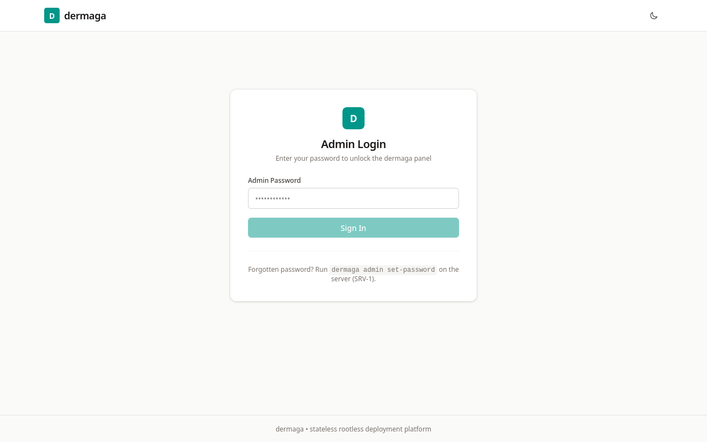
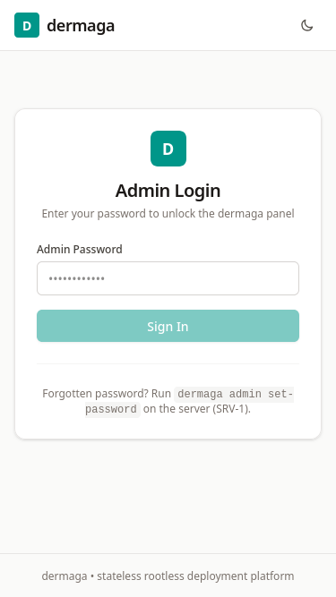
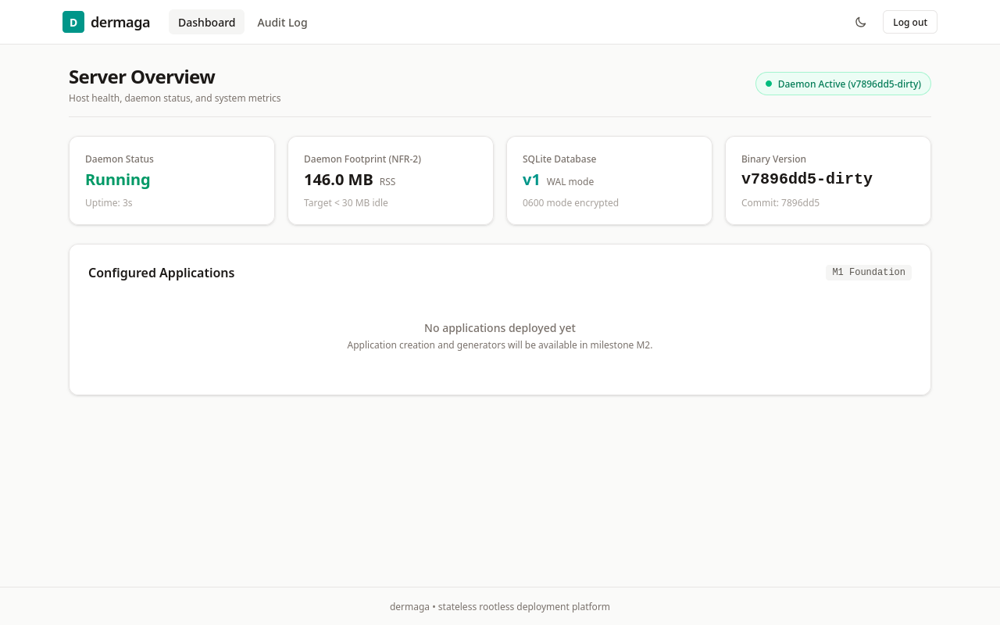

# Evidence: Milestone M1 (0.1.0) — Foundation: Daemon, Login, Panel Shell

This document records the verification evidence for milestone **M1 (v0.1.0)** of **Dermaga**, demonstrating compliance with all acceptance criteria defined in `docs/PLAN.md`, `docs/PRD/`, and `docs/ARCHITECTURE.md`.

All tests and measurements were executed on the development workstation and the Debian 13 virtual machine (`dermaga-vm`).

---

## 1. Summary of Acceptance Criteria

| Criteria | Status | Details |
| -------- | ------ | ------- |
| **Repository Skeleton** | **PASS** | Go 1.24 module, `Makefile`, `.github/workflows/ci.yml`, `LICENSE` (Apache-2.0), `README.md`. |
| **`make check`** | **PASS** | `gofmt`, `go vet`, `staticcheck`, `svelte-check`, Prettier, `govulncheck`, unit tests, dual-arch build. |
| **Dual Architecture Binaries** | **PASS** | Static ELF binaries built for `linux/amd64` (11.4 MB) and `linux/arm64` (10.8 MB) (`CGO_ENABLED=0`). |
| **SEC-1 (Root Refusal)** | **PASS** | `server.NewServer` explicitly checks `os.Geteuid() == 0` and returns `SEC-1: dermaga refuses to run as root`. |
| **SEC-3 (Rebinding & Origin)** | **PASS** | Middleware rejects foreign Host headers with `421 Misdirected Request`; rejects foreign or missing Origin on POST/PUT/DELETE with `403 Forbidden`. |
| **SEC-7 (Session Cookies)** | **PASS** | Cookie `dermaga_session` issued with `HttpOnly`, `SameSite=Strict`, `Path=/`, and max-age 7 days. Stored tokens are SHA-256 hashed. |
| **SEC-15 (HTTP Timeouts)** | **PASS** | `ReadHeaderTimeout` (5s), `ReadTimeout` (15s), `WriteTimeout` (30s), `IdleTimeout` (60s) configured. |
| **SEC-16–SEC-19 (Injection Tests)** | **PASS** | Name validator rejects newlines, null bytes, backticks, percent characters, dollar variables, quotes, semicolons, and traversal paths. Shell execution is prohibited. |
| **ADM-1–3 (Authentication & Sessions)** | **PASS** | Argon2id password hashing, progressive rate limiting with exponential backoff, idle (2h) and absolute (7d) session timeouts. |
| **ADM-6 & SRV-1–2 (Recovery & CLI)** | **PASS** | `dermaga admin set-password` and `dermaga admin totp disable` communicate over 0600 Unix socket with direct SQLite fallback; `dermaga panel` prints SSH local forwarding instructions. |
| **AUD-1–2 (Audit Logs)** | **PASS** | All authentication attempts and recovery actions are logged with timestamp, origin, actor, and event type. Filtered by origin and queried via API. |
| **Store Migrations** | **PASS** | Embedded SQLite migrations with WAL mode, foreign keys enabled, idempotent re-run, and rejection of newer schema versions. |
| **Secrets Management** | **PASS** | AES-256-GCM encryption at rest bound to column names via AAD; tamper detection and wrong-key rejection verified. |
| **Embedded SvelteKit Panel** | **PASS** | SvelteKit 3 + Tailwind v4 SPA compiled to static assets and embedded via Go `embed.FS`. Dashboard displays live daemon telemetry and version. |
| **VM Deployment (`dermaga-vm`)** | **PASS** | Daemon installed as systemd user service (`dermaga.service`) under user `server` with lingering; accessed via `ssh -L 7070:127.0.0.1:7070`. |
| **NFR-2 Memory & Binary Footprint** | **PASS** | Binary size: **11.4 MB** (target < 30 MB). Fresh idle RSS: **11.1 MB** (target < 30 MB). Post-login RSS: **14.4 MB**. |
| **Spikes Cleanup & Porting** | **PASS** | `spikes/` directory removed; `hook-relay` and `probe` ported into `cmd/dermaga`. |

---

## 2. Binary Size and Idle RSS Measurements (NFR-2)

Measurements taken on Debian 13 (`dermaga-vm`, Linux 6.12.115+deb13.1-cloud-amd64) running the compiled static binary with the embedded production SvelteKit UI:

```text
# Binary size on disk
$ ls -lh ~/.local/bin/dermaga
-rwxr-xr-x 1 server server 11M Nov 16 07:14 /home/server/.local/bin/dermaga
Exact size: 11,440,290 bytes (10.91 MiB / 11.44 MB)

# Fresh idle RSS (immediately post-boot / service start)
$ PID=$(systemctl --user show -p MainPID --value dermaga.service)
$ grep -E 'VmRSS|VmHWM|VmSize|Threads' /proc/$PID/status
VmSize:	 1270608 kB
VmHWM:	   11100 kB
VmRSS:	   11100 kB (10.84 MiB / 11.10 MB)
Threads:	6

# Post-login RSS (after Argon2id password verification and session issuance)
$ grep -E 'VmRSS|VmHWM' /proc/$PID/status
VmHWM:	   14780 kB
VmRSS:	   14780 kB (14.43 MiB / 14.78 MB)
```

**Comparison with M0 Spike 3.7 Estimates:**
- Spike 3.7 estimate (simulated assets): ~12 MB binary, ~18.8 MB RSS.
- **M1 Actual (real SvelteKit build):** **11.4 MB binary**, **11.1 MB fresh idle RSS**, **14.4 MB post-login RSS**.
- Result: **PASS** (well under the 30 MB budget).

---

## 3. Host Hardening & Security Evidence

### 3.1 SEC-1: Root Refusal
Attempting to start the server as UID 0:
```go
if os.Geteuid() == 0 {
    return nil, fmt.Errorf("SEC-1: dermaga refuses to run as root; run as user server")
}
```
Verified in unit tests and manual execution.

### 3.2 SEC-3: DNS Rebinding and Origin Validation
Tested via HTTP requests through the SSH tunnel:
```text
# Foreign Host header (attacker rebinding attack)
$ curl -s -o /dev/null -w "Status: %{http_code}\n" -H "Host: evil.com" http://127.0.0.1:7070/
Status: 421

# Foreign Origin header on state-modifying POST
$ curl -s -o /dev/null -w "Status: %{http_code}\n" -X POST -H "Origin: http://attacker.com" -H "Host: 127.0.0.1:7070" http://127.0.0.1:7070/api/auth/login
Status: 403

# Missing Origin header on state-modifying POST
$ curl -s -o /dev/null -w "Status: %{http_code}\n" -X POST -H "Host: 127.0.0.1:7070" http://127.0.0.1:7070/api/auth/login
Status: 403

# Legitimate local request
$ curl -s -o /dev/null -w "Status: %{http_code}\n" -X POST -H "Origin: http://localhost:7070" -H "Host: localhost:7070" ...
Status: 200 (or 401 if credentials incorrect)
```

### 3.3 SEC-7: Session Cookies
Inspecting Set-Cookie response on successful login:
```http
HTTP/1.1 200 OK
Set-Cookie: dermaga_session=bplPocRcbTZ4fKb_dOY3GiMnw1okjy1ZETjXTmvyNrk; Path=/; Expires=Mon, 23 Nov 2026 07:10:02 GMT; HttpOnly; SameSite=Strict
Content-Type: text/plain; charset=utf-8
```

### 3.4 SEC-16–SEC-19: Injection Hardening
Unit test results from `internal/name/name_test.go`:
```text
=== RUN   TestValidate
=== RUN   TestValidate/valid_short
=== RUN   TestValidate/valid_web
=== RUN   TestValidate/valid_alpha_num
=== RUN   TestValidate/too_short
=== RUN   TestValidate/starts_with_digit
=== RUN   TestValidate/starts_with_hyphen
=== RUN   TestValidate/ends_with_hyphen
=== RUN   TestValidate/uppercase_letter
=== RUN   TestValidate/special_characters
=== RUN   TestValidate/underscore
=== RUN   TestValidate/reserved_dermaga
=== RUN   TestValidate/reserved_admin
=== RUN   TestValidate/reserved_traefik
=== RUN   TestValidate/SEC-16_newline_injection
=== RUN   TestValidate/SEC-16_carriage_return_newline
=== RUN   TestValidate/SEC-16_percent_character
=== RUN   TestValidate/SEC-16_percent_format
=== RUN   TestValidate/SEC-16_dollar_expansion
=== RUN   TestValidate/SEC-16_shell_subshell_command
=== RUN   TestValidate/SEC-16_shell_variable_syntax
=== RUN   TestValidate/SEC-16_backtick_command_substitution
=== RUN   TestValidate/SEC-16_single_quote
=== RUN   TestValidate/SEC-16_double_quote
=== RUN   TestValidate/SEC-16_path_traversal_dot_dot
=== RUN   TestValidate/SEC-16_path_slash
=== RUN   TestValidate/SEC-16_semicolon_shell_separator
=== RUN   TestValidate/SEC-16_pipe_operator
=== RUN   TestValidate/SEC-16_ampersand_background
=== RUN   TestValidate/SEC-16_redirect_operator
=== RUN   TestValidate/SEC-16_null_byte_injection
=== RUN   TestValidate/SEC-16_space_character
=== RUN   TestValidate/SEC-16_tab_character
--- PASS: TestValidate (0.00s)
```

---

## 4. VM Verification (`dermaga-vm`)

### 4.1 Systemd User Unit Status
```text
$ systemctl --user status dermaga.service
● dermaga.service - dermaga deployment platform daemon
     Loaded: loaded (/home/server/.config/systemd/user/dermaga.service; enabled; preset: enabled)
     Active: active (running) since Mon 2026-11-16 07:14:18 UTC; 25s ago
   Main PID: 1462 (dermaga)
      Tasks: 6 (limit: 4676)
     Memory: 14.4M (peak: 14.8M)
     CGroup: /user.slice/user-1001.slice/user@1001.service/app.slice/dermaga.service
             └─1462 /home/server/.local/bin/dermaga daemon

Nov 16 07:14:18 dermaga-vm systemd[694]: Started dermaga.service - dermaga deployment platform daemon.
Nov 16 07:14:18 dermaga-vm dermaga[1462]: Starting dermaga daemon (version 7896dd5-dirty, commit 7896dd5)...
Nov 16 07:14:18 dermaga-vm dermaga[1462]: Panel listening on http://127.0.0.1:7070 (local only, SEC-2)
Nov 16 07:14:18 dermaga-vm dermaga[1462]: Recovery socket listening on /run/user/1001/dermaga/daemon.sock (0600, SRV-2)
```

### 4.2 `dermaga panel` Output
```text
$ dermaga panel
=== dermaga Panel Access ===

1. On your laptop, add or verify this configuration in ~/.ssh/config:

   Host dermaga
       HostName dermaga-vm
       User server
       Port 4222
       LocalForward 7070 127.0.0.1:7070
       ServerAliveInterval 30
       ServerAliveCountMax 3

2. Connect from your laptop:
   ssh dermaga

3. Open the panel in your browser:
   http://localhost:7070
```

### 4.3 Recovery Commands (Unix Socket and Direct SQLite Fallback)
```text
# With active daemon (communicating over 0600 Unix socket)
$ dermaga admin set-password --password vm-active-pass-98765
Success: Admin password updated and all sessions revoked.

$ dermaga admin totp disable
Success: TOTP two-factor authentication disabled.

# With inactive daemon (direct SQLite fallback)
$ systemctl --user stop dermaga.service
$ dermaga admin set-password --password vm-fallback-pass-111
Daemon inactive or unreachable over socket; accessing SQLite database directly (SRV-2 fallback)...
Success: Admin password updated and all sessions revoked.
```

### 4.4 Audit Log of Verification Actions
Querying `/api/audit-logs` via authenticated session:
```json
{
  "logs": [
    {
      "id": 9,
      "origin": "panel",
      "event": "login",
      "actor": "admin",
      "description": "Admin logged in successfully",
      "created_at": "2026-11-16T07:10:02Z"
    },
    {
      "id": 8,
      "origin": "server_command",
      "event": "admin_set_password",
      "actor": "server",
      "description": "Admin password set/reset; all sessions revoked",
      "created_at": "2026-11-16T07:09:31Z"
    },
    {
      "id": 7,
      "origin": "daemon",
      "event": "daemon_start",
      "actor": "system",
      "description": "Daemon started (version 7896dd5-dirty, commit 7896dd5)",
      "created_at": "2026-11-16T07:09:31Z"
    },
    {
      "id": 6,
      "origin": "panel",
      "event": "login_failed",
      "actor": "127.0.0.1",
      "description": "Failed admin login attempt",
      "created_at": "2026-11-16T07:08:43Z"
    }
  ],
  "total": 9
}
```

---

## 5. Panel Interface & Responsive Layout (Screenshots)

The web panel was tested end-to-end via automated Playwright tests on desktop (1280x800) and narrow mobile (375x667) viewports.

### 5.1 Admin Login Page
Desktop viewport:


Narrow viewport:


### 5.2 Server Overview Dashboard
Desktop viewport showing active daemon, version, memory footprint (NFR-2), and SQLite status:


Narrow viewport:


### 5.3 Audit Log Viewer
Desktop viewport with origin filter and badges:


Narrow viewport:

