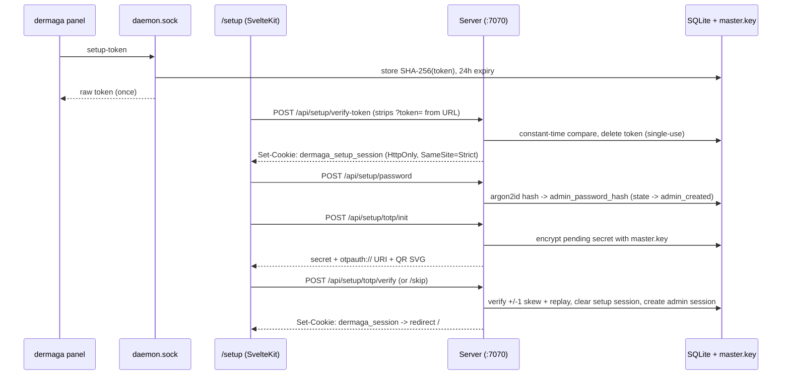

# Evidence: M4 (0.4.0) — First-run setup and panel access

Commit under review: `55544cb` + M4a working tree (checkpoint **M4a**).

## Acceptance criteria

| Criterion (req ID) | Status | Log file | Excerpt (≤20 lines) |
| --- | --- | --- | --- |
| SETUP-1: setup mode redirect & API refusal | PASS | `tmp/evidence/M4/logs/make-check.log` | `TestSetupModeEnforcement_SETUP1_SEC3` |
| SEC-8: 32B hashed single-use token, 24 h expiry, rate-limited, SEC-3 | PASS | `tmp/evidence/M4/logs/make-check.log` | `TestSetupTokenLifecycle_SEC8`, `TestSetupFlowWithTOTP_SETUP2_SEC8_ADM1` |
| SETUP-2: password + strength meter + skippable TOTP QR & warning | PASS | `tmp/evidence/M4/logs/playwright-e2e.log` | `5 passed (16.3s)` (Firefox + axe WCAG AA) |
| DOC-2: `doctor` warns when TOTP is disabled | PASS | `tmp/evidence/M4/logs/make-check.log` | `TestDoctorTOTPWarning_DOC2` |
| SETUP-3, INST-12: `dermaga panel` via `daemon.sock` + `install.sh` link | PASS (local) | `tmp/evidence/M4/logs/make-check.log` | `TestSetupFlowSkipTOTPAndSocketToken_SETUP2_SETUP3`, `TestCLIPanel_InactiveDaemon` |
| QR library query (`skip2/go-qrcode` vs `rsc.io/qr`) | decision recorded | `tmp/evidence/M4/logs/qr-library-query.log` | `DEPENDENCIES.md` §1–2 |
| VM fresh-install journey (`dermaga-vm` from `fresh`) | NOT RUN | — | Needs owner pre-release tag `v0.4.0-rc.1`; see commands below |

### `tmp/evidence/M4/logs/make-check.log`

```text
ok   ui
ok   lint
ok   test
ok   vulncheck
ok   build-all
ok   policy
SKIP shellcheck (not installed)
=== make check passed successfully ===
# Exit: 0
```

### `tmp/evidence/M4/logs/playwright-e2e.log`

```text
  ✓  1 [firefox] › e2e/panel.test.ts:87:3 › Dermaga Theme & Panel Journeys (M1-dark) › system preference prefers-color-scheme: dark produces fully dark page without saved choice (2.4s)
  ✓  3 [firefox] › e2e/panel.test.ts:106:3 › Dermaga Theme & Panel Journeys (M1-dark) › unauthenticated access redirects to /login (652ms)
  ✓  2 [firefox] › e2e/setup.test.ts:137:3 › First-Run Setup Journey (M4a: SETUP-1, SETUP-2, SETUP-3, SEC-8) › full setup with TOTP enrolment, theme/viewport axe AA checks, and TOTP login (6.5s)
  ✓  5 [firefox] › e2e/setup.test.ts:219:3 › First-Run Setup Journey (M4a: SETUP-1, SETUP-2, SETUP-3, SEC-8) › skipping TOTP shows persistent warning banner in panel (2.1s)
  ✓  4 [firefox] › e2e/panel.test.ts:112:3 › Dermaga Theme & Panel Journeys (M1-dark) › full panel journeys, theme switching, computed backgrounds, and axe AA contrast (11.6s)

  5 passed (16.3s)
# Exit: 0
```

### VM fresh-install commands (for owner after tagging `v0.4.0-rc.1`)

```bash
# 1. Revert dermaga-vm to fresh (owner approval) and ensure reboot policy
virsh --connect qemu:///system snapshot-revert dermaga-vm fresh
virt-xml --connect qemu:///system dermaga-vm --edit --events on_reboot=restart
virsh --connect qemu:///system start dermaga-vm

# 2. Run installer from v0.4.0-rc.1 release (prints laptop command + setup?token=... link)
ssh -t dermaga-vm-init 'curl -fsSL https://github.com/r3p-dev/dermaga/releases/download/v0.4.0-rc.1/install.sh | sudo bash'

# 3. On workstation: paste laptop command, run `ssh dermaga`, open printed http://localhost:7070/setup?token=...
```

## Run & view

- Local checks: `make check` and `make build && (cd ui && EVIDENCE_MILESTONE=M4 bunx playwright test)`.
- Demo state script: `test/vm/seed.sh` verifies `dermaga.service` and `traefik.service`, runs `dermaga doctor`, and runs `dermaga panel` to print the SSH tunnel command and active setup/panel URL.
- In browser (`http://localhost:7070`): while uninitialized, `/` and `/login` redirect to `/setup`; pasting or opening `?token=...` exchanges the single-use token, sets the admin password, and offers TOTP QR enrolment (or skip with a persistent warning banner).

## Screens

| Local file | Page | Width | Theme | Shows |
| --- | --- | --- | --- | --- |
| `tmp/evidence/M4/screenshots/m4a-setup-token-light-desktop.png` | `/setup` (token) | 1280 | light | Token paste form with PRD `dermaga panel` guidance |
| `tmp/evidence/M4/screenshots/m4a-setup-password-light-desktop.png` | `/setup` (step 1) | 1280 | light | 3-step indicator, password fields, 4-segment green `Strong` meter |
| `tmp/evidence/M4/screenshots/m4a-setup-totp-light-desktop.png` | `/setup` (step 2) | 1280 | light | Inline QR code SVG, copyable Base32 key, `otpauth://` URI |
| `tmp/evidence/M4/screenshots/m4a-setup-totp-dark-narrow.png` | `/setup` (step 2) | 375 | dark | Responsive 3-step header and crisp QR code on dark surface |
| `tmp/evidence/M4/screenshots/m4a-login-totp-dark-desktop.png` | `/login` (TOTP) | 1280 | dark | Password + 6-digit TOTP authenticator prompt |
| `tmp/evidence/M4/screenshots/m4a-dashboard-totp-warning-light.png` | `/` (post-skip) | 1280 | light | Persistent amber TOTP-disabled warning and hook-domain notice |

## How it works



## Code tour

1. `internal/auth/setup.go`: setup state machine (`uninitialized` → `admin_created` → `domain_set` → `ready`), 32-byte setup token issuance/exchange (`SEC-8`), setup session validation.
2. `internal/auth/totp.go`: stdlib RFC 6238 TOTP generation/verification (±1 skew, replay step tracking) and `go-qrcode` SVG rendering.
3. `internal/server/setup.go`: `/api/setup/*` handlers, setup session cookie helpers, encrypted TOTP enrolment.
4. `internal/server/server.go`: setup-mode redirect middleware, API refusal in setup mode, TOTP check on `/api/auth/login`, `setup-token` over `daemon.sock`.
5. `internal/doctor/doctor.go`: `DOC-2` TOTP warning check.
6. `cmd/dermaga/main.go` & `install/install.sh`: `dermaga panel` setup link via `daemon.sock` and installer summary fallback hint.
7. `ui/src/routes/setup/+page.svelte`, `login/+page.svelte`, `+layout.svelte`: setup wizard, URL token stripping, TOTP login, persistent warnings.

## Decisions & deviations

- **ARCHITECTURE §5.2 & §6.3:** Updated §5.2 step 2 from mandatory/`SEC-1` to skippable TOTP with persistent warning (`SETUP-2`), and clarified `admin_created` in §6.3 so the panel is usable while hook domain setup remains pending for M4b.
- **QR dependency (`DEPENDENCIES.md`):** Added `github.com/skip2/go-qrcode` (`v0.0.0-20200617195104-da1b6568686e`, MIT, zero transitive deps) over `rsc.io/qr` (`v0.2.0`, 2018).
- **Token issuance (`SETUP-3`):** `dermaga panel` requests tokens over `daemon.sock` so the daemon remains the single SQLite writer, failing with a clear error when the daemon is down.

## Known limitations / deferred

- **M4b scope:** Hook-domain step + DNS check (`SETUP-2`), `TLS-5` + Pebble ACME without e-mail (`DEC-20`), `LAP-3`, `ADM-4`, `ADM-5`, `SEC-10`, and narrow-screen stacked audit log rows.
- **VM fresh-install run:** Deferred until owner tags `v0.4.0-rc.1`.
- **LLMNR port 5355:** Pre-existing open port on `fresh` before `apply_firewall` (carried over from M3b).

## Suggested commits

See `scripts/check-commits tmp/evidence/M4/commits.plan`.
