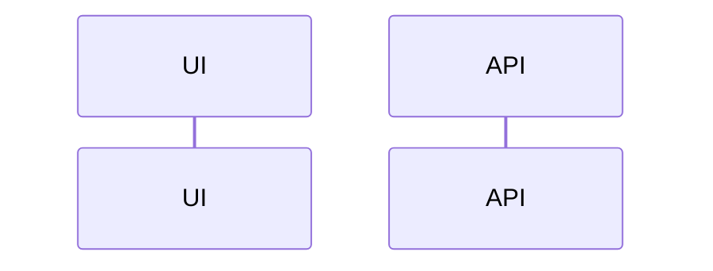

# Evidence: M<N> (<version>) — <milestone name>

<!-- Copy to docs/evidence/M<N>/EVIDENCE.md; it is the only file committed for the milestone
(AGENTS.md "Evidence", DEC-26). Logs come from scripts/evidence-run (one per criterion) and stay in
the gitignored tmp/evidence/M<N>/logs/; screenshots in tmp/evidence/M<N>/screenshots/. Excerpts are
exact text from those local logs, from the commit under review, at most ~20 lines, with the log path
cited. Status: PASS, FAIL, NOT RUN (with the commands for the owner) or decision recorded. -->

Commit under review: `<short sha>` (clean | dirty: why). Checkpoint: <M<N>a | M<N>b | whole milestone>.

## Acceptance criteria

| Criterion (req ID) | Status | Log file | Excerpt (≤20 lines) |
| --- | --- | --- | --- |
| <ID: short criterion> | PASS | `tmp/evidence/M<N>/logs/<name>.log` | see below |
| <ID: negative control for the check above> | PASS | `tmp/evidence/M<N>/logs/<name>-negative.log` | see below |
| <ID: not runnable here> | NOT RUN | — | `<exact commands for the owner>` |
| <decision or docs item> | decision recorded | — | DEC-<n> |

### <ID>: <name>.log

```text
<exact lines copied from tmp/evidence/M<N>/logs/<name>.log>
```

## Run & view

Exact commands from a clean checkout and on `dermaga-vm`, the SSH tunnel and URLs, the demo state
(`test/vm/seed.sh`), and what to click to see each new thing.

## Screens

Every new or changed panel page, desktop and narrow, captured with
`EVIDENCE_MILESTONE=M<N> make test-browser` into `tmp/evidence/M<N>/screenshots/` (never committed).
Open each one before `PASS` and describe it in one line.

| Local file | Page | Width | Theme | Shows |
| --- | --- | --- | --- | --- |
| `tmp/evidence/M<N>/screenshots/<page>-desktop-light.png` | <page> | 1280 | light | <one line> |
| `tmp/evidence/M<N>/screenshots/<page>-narrow-dark.png` | <page> | 375 | dark | <one line> |

## How it works

Each new flow from the click (or webhook, or daemon) to the host and back: UI → API route →
handler → package → host command or generated file → result, with a short sequence.



## Code tour

New or changed files in reading order, one line each.

1. `<path>`: <what to look for>

## Decisions & deviations

Decisions taken (with their DEC-<n>), deviations from the documents, every workaround added with its
reason, every significant action, and anything done as root (with the owner's approval).

## Known limitations / deferred

- <item>: <why, and the milestone that picks it up>

## Suggested commits

Only the summary lines of `scripts/check-commits tmp/evidence/M<N>/commits.plan` (one per commit).
